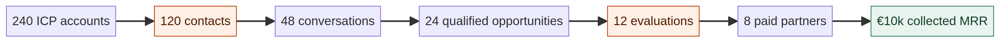

# VOID €10k MRR reality-check

**Review date:** 2026-09-30  
**Reviewed artifacts:** `GO-TO-MARKET-10K-MRR.md`, `GO-TO-MARKET-10K-MRR-2026.md`, `10K-MRR-EXECUTION-BOARD.md`  
**Purpose:** determine whether the December 2026 €10k MRR target is realistic, what must be true for it to happen, and when to reforecast.

> [!IMPORTANT]
> **Management verdict:** €10k MRR is an **upside/stretch target**, not the current base-case forecast. Until two paid accounts and source-specific conversion data exist, manage to **€2k–€5k base-case MRR**.

### Executive dashboard

| Signal | Current read | Management action |
| --- | --- | --- |
| **Upside target** | €7.5k–€10k MRR | Keep as target; do not call it expected revenue |
| **Base case** | €2k–€5k MRR | Use for staffing, support, and cash planning |
| **Downside** | €0–€1k MRR | Trigger activation and wedge intervention |
| **Biggest risk** | 66.7% evaluation → paid assumption | Measure by cohort; plan 25–50% until proven |
| **Pipeline requirement** | €30k–€50k qualified recurring pipeline | Review weekly in `#operations` |

**Reading the chart:** the original path works only with unusually strong warm-channel conversion. The chart is a target path, not a forecast.

### Navigation

- [Execution board](10K-MRR-EXECUTION-BOARD.md)
- [Date-bound plan](GO-TO-MARKET-10K-MRR-2026.md)
- [Slack operating pack](SLACK-OPERATING-PACK.md)

## Executive verdict

The target is **possible but not currently a realistic base-case**. It is a stretch/upside case that requires three things the repository does not yet evidence:

1. a working, independently reproducible activation path;
2. repeated buyer urgency and willingness to pay;
3. a warm or highly targeted acquisition channel capable of producing enough qualified evaluations inside a short 12-week window.

The plan should keep €10k as the **upside target**, but add a base-case operating forecast of **€3k–€6k MRR** and a downside case of **€0–€2.5k MRR** until the first paid design partners and conversion data exist. The plan must reforecast from actual stage data, not defend the original number.

## 1. What is mathematically sound

The primary package math is correct:

- 8 design partners × €1,250 MRR = €10,000 MRR.
- 41 Team accounts × €249 MRR = €10,209 MRR.
- 20 Team accounts × €249 + 4 design partners × €1,300 = €10,180 MRR.

The strategy is also correct to prefer design partners over 41 low-touch Team accounts while the install, support, and release paths are immature.

The existing target funnel is:

| Stage | Count | Conversion from prior stage |
| --- | ---: | ---: |
| Named ICP accounts | 240 | — |
| Personalized contacts | 120 | 50% of accounts |
| First conversations | 48 | 40% of contacts |
| Qualified opportunities | 24 | 50% of conversations |
| Scoped evaluations | 12 | 50% of qualified opportunities |
| Paid design partners | 8 | 66.7% of evaluations |

End-to-end, this implies **8 paid accounts from 240 named accounts = 3.33% account-to-paid conversion**.

That is not impossible for a very warm, founder-led network. It is not a safe assumption for cold outbound to a new category with no validated references.

## 2. Benchmark comparison

Public benchmark sources are directional, not a substitute for VOID's own data:

- HiBob, summarizing First Page Sage and Gartner ranges, reports roughly **50–62% SQL→opportunity** and **15–30% opportunity→close** for common B2B funnel stages: https://www.hibob.com/blog/sales-funnel-conversion-rate/
- Outreach describes broad B2B **opportunity-to-close ranges of 25–50%**, with enterprise SaaS lower because buying committees and sales cycles are more complex: https://www.outreach.ai/resources/blog/pipeline-conversion-rate-benchmarks
- Autobound reports roughly **1–4% of outbound sequences booking a meeting**, **10–15% of meetings becoming opportunities** in top-performing SaaS outbound examples, and emphasizes that channel mix and targeting dominate volume: https://www.autobound.ai/blog/10-outbound-sales-benchmarks-crushing-it-for-100-saas-companies-and-how-to-steal-their-playbook

Implications for the current plan:

- **Accounts → contacts at 50%:** possible only if the 240 accounts are already well researched and reachable; do not treat this as a cold-list assumption.
- **Contacts → first conversations at 40%:** too high for generic cold outreach. Retain only for warm introductions or highly signal-based outreach. For cold/mixed outbound, plan on a lower rate and measure separately.
- **Conversations → qualified at 50%:** plausible if the qualification rule is enforced and conversations are strongly ICP-filtered; otherwise it is inflated.
- **Qualified → scoped evaluation at 50%:** possible for urgent pain with a disposable environment; too high for curiosity-led conversations.
- **Evaluation → paid at 66.7%:** the most optimistic assumption. It should be treated as an upside outcome, not a base conversion rate. Use 25–50% as an initial planning range until VOID has its own 90-day cohort data.

## 3. Scenario model

### Downside: evidence and activation lag

Assumptions:

- 240 accounts;
- 10% contact-to-conversation;
- 25% conversation-to-qualified;
- 25% qualified-to-evaluation;
- 25% evaluation-to-paid;
- average €1,000 MRR.

Result: approximately **0–1 paid account and €0–€1,000 MRR** by year-end, depending on sales-cycle timing. This is the correct downside if the product path is not independently activatable or the wedge is not urgent.

### Base case: first repeatable learning loop

Assumptions:

- 240 accounts with a mix of warm introductions and targeted outbound;
- 20% contact-to-conversation;
- 40% conversation-to-qualified;
- 40% qualified-to-evaluation;
- 35% evaluation-to-paid;
- average €1,000–€1,250 MRR.

Result: approximately **2–4 paid accounts and €2,000–€5,000 MRR** by year-end. This is the working forecast until actual conversion data replaces the assumptions.

### Upside: strong warm channel and clean activation

Assumptions:

- the 240 accounts are not merely names but high-fit, signal-based targets;
- a founder network, partners, technical community, or referrals materially improve meeting rates;
- the five-minute activation path works without maintainer intervention;
- 12–16 evaluations are created;
- 50–67% of evaluations become paid scoped partners;
- average €1,250 MRR.

Result: **6–8 paid accounts and €7,500–€10,000 MRR**. This is the current target, but it requires evidence from the first two cohorts; it should not be presented as the expected result.

### Scenario table

| Scenario | Paid accounts | Average MRR | Expected MRR | Status |
| --- | ---: | ---: | ---: | --- |
| Downside | 0–1 | €1,000 | €0–€1,000 | Risk case |
| Base | 2–4 | €1,000–€1,250 | €2,000–€5,000 | Working forecast |
| Upside | 6–8 | €1,250 | €7,500–€10,000 | Stretch target |

## 4. Corrected funnel requirement for €10k

If evaluation-to-paid conversion settles at 33%, the team needs approximately **24 scoped evaluations to close 8 accounts**. If qualified-to-evaluation is 40%, that requires **60 qualified opportunities**. At 40% conversation-to-qualified, that requires **150 first conversations**. At 20% contact-to-conversation, that requires **750 personalized contacts**.

Therefore the original `240 → 120 → 48 → 24 → 12 → 8` funnel is sufficient only if conversion is unusually strong. It is not a robust pipeline requirement.

The professional planning rule should be:

- carry **3×–5× qualified pipeline coverage** against the target MRR;
- measure every stage by source: warm intro, referral, partner, community, cold email, LinkedIn, event, and inbound;
- use rolling 90-day conversion rates once enough observations exist;
- never mix cold and warm conversion rates into one flattering average.

At €1,250 average MRR, €10k target MRR means at least €30k–€50k of qualified recurring pipeline coverage. That is approximately 24–40 qualified opportunities before applying stage probability.

## 5. Capacity reality-check

Eight design partners are not eight passive subscriptions. The current offer includes a named workflow, weekly working sessions, bounded adapter/policy support, evidence review, and a written outcome.

Before accepting the target, record:

- founder hours available per week;
- engineering hours available per week;
- maximum concurrent evaluations;
- expected support hours per account;
- time to first hold;
- time to verified export;
- maximum number of custom requests per account;
- gross margin after support and implementation time.

A safe initial operating cap is **2–3 concurrent evaluations per engineer or operator**, unless onboarding is demonstrably self-serve. If eight partners each need weekly support, the founder may be committing to 8+ recurring customer sessions before product work, sales, and incident response are counted.

A deal should be refused or re-scoped when it requires unlimited integration work, production credentials, unsupported hosting, or a success promise without an evidence path.

## 6. Go / no-go reforecast gates

These gates replace optimism with observable evidence:

| Date | Continue €10k upside target only if | Otherwise |
| --- | --- | --- |
| Oct 11 | clean-machine activation works for an independent operator | freeze outreach expansion; fix activation |
| Oct 18 | ≥5 qualified conversations and ≥1 activated evaluation | reforecast to base case and change message/ICP |
| Nov 1 | ≥3 scoped evaluations and ≥1 written paid proposal | €10k becomes stretch-only; set Jan/Feb recovery target |
| Nov 15 | ≥2 collected paid accounts or a very strong late-stage pipeline | stop assuming December attainment; protect delivery quality |
| Nov 29 | ≥4 paid accounts and ≥12 qualified opportunities still active | use only an evidence-backed blended fallback |
| Dec 13 | ≥6 paid accounts, January renewal path, and no critical activation blocker | publish the miss-risk internally; do not sell unsupported scope |
| Dec 31 | ≥€10k collected MRR reconciled to source records | report achieved, partial, or missed without rounding up |

## 7. Changes required to the existing plan

1. Label €10k as **upside/stretch**, not the base-case forecast.
2. Add the €2k–€5k base-case range to the weekly scorecard.
3. Replace the single funnel with source-specific cohorts and scenario assumptions.
4. Change evaluation-to-paid from a planning assumption of 66.7% to a measured range of 25–50% until actual data exists.
5. Add maximum concurrent evaluations and support capacity to Phase 0.
6. Add qualified pipeline coverage in euros, not only account counts.
7. Add a December deadline rule: do not close a deal that makes the target look better but creates unsupported delivery or renewal risk.
8. Track sales-cycle length and stage aging; a late-stage opportunity that slips is not equivalent to a lost lead.

## 8. Decision

Keep the target. Reclassify it:

> **€10k MRR by 2026-12-31 is a stretch target with a credible path, not a realistic base-case forecast. The base case is €2k–€5k MRR until two paid accounts, repeatable activation, and source-specific conversion data prove otherwise.**

The team should optimize for learning velocity and renewal-quality evidence first. If the target is missed, the plan remains successful only if the team produces a repeatable wedge, honest conversion data, and a credible next-quarter revenue path.
