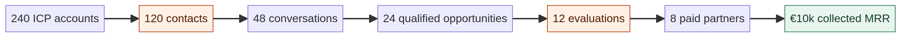
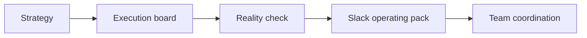

# VOID: first €10k MRR go-to-market and operating plan

Status: execution plan, created 2026-09-30.
Owner: founder, with workstream DRIs assigned in the team workspace.
Source of truth: this document and the linked GitHub issue. Slack is the operating surface, not the canonical record of product truth.

Execution layer: [10K-MRR-EXECUTION-BOARD.md](10K-MRR-EXECUTION-BOARD.md) contains the ready-to-run task board, DRI contract, weekly scorecard, evidence gates, content sequence, and stop rules. [SLACK-OPERATING-PACK.md](SLACK-OPERATING-PACK.md) contains the channel map, cadence, pin-ready rules, and message templates. Keep those documents aligned with this strategy; do not create a competing plan in Slack.

Marketing and monetization research: [VOID-MARKETING-MONETIZATION-RESEARCH-2026.md](VOID-MARKETING-MONETIZATION-RESEARCH-2026.md). Ready-to-review social assets: [VOID-SOCIAL-CONTENT-PACK-2026.md](VOID-SOCIAL-CONTENT-PACK-2026.md). These documents sharpen positioning and demand generation; they do not override the revenue reality-check or evidence gates.

> [!IMPORTANT]
> **Executive status:** €10k MRR is an upside/stretch target. The current operating base case is **€2k–€5k MRR** until two paid accounts, repeatable activation, and source-specific conversion data exist.

## Executive dashboard

| Track | Green signal | Current control |
| --- | --- | --- |
| **Revenue** | collected MRR reconciles to source records | do not count unpaid or one-off revenue |
| **Demand** | repeated workflow pain + dated next steps | first 20 conversations are evidence collection |
| **Activation** | independent operator completes hold + export + verification | maintainer intervention is a blocker |
| **Pipeline** | 3×–5× qualified recurring coverage | €30k–€50k for €10k target MRR |
| **Delivery** | support remains within capacity | re-scope unlimited integration requests |

### Document map

- [Date-bound target](GO-TO-MARKET-10K-MRR-2026.md)
- [Execution board](10K-MRR-EXECUTION-BOARD.md)
- [Reality check](10K-MRR-REALITY-CHECK.md)
- [Slack operating pack](SLACK-OPERATING-PACK.md)

## 1. Objective and definition of done

The objective is the first €10,000 of collected monthly recurring revenue from VOID customers, measured for three consecutive months. One-off setup fees, unpaid pilots, grants, consulting that is not recurring, and illustrative numbers on the marketing site do not count.

The program is complete when all of the following are true:

- €10,000 or more of recurring revenue is collected in month three of the target run.
- Every paying account has a named owner, contract scope, renewal date, support path, and a recorded reason for purchase.
- At least one customer can independently verify a signed VOID ledger export without trusting the VOID runtime.
- The install, first hold, approval, ledger verification, and recovery path are reproducible by a person who did not build the product.
- The team can answer which channel produced each qualified conversation, pilot, and paid account.
- No customer, logo, security certification, performance number, or compliance claim is published unless it is verified and approved for publication.

This document is a revenue execution plan. It does not turn a development status into a production claim, and it does not replace the technical release gates in docs/RELEASE.md, docs/PLAN-GAPS.md, or docs/DISTRIBUTION-PATH.md.

## 2. Current reality

VOID is an accountability and reversibility layer for AI agent actions. The product intercepts a tool call, classifies its effect, applies policy, allows, denies, or holds it, and records the decision in a signed ledger. The current source repository is Dawe583/void. Dawe583/void-empty is the marketing site and API mirror; product capabilities and registry data originate in Dawe583/void.

The current evidence does not prove market demand. The Q4 roadmap records negative external evidence: no security team buying signed, attributable agent action was found in the research available to the repository. That is not a reason to stop. It is a reason to treat the first 20 buyer conversations as an evidence collection program, not as a launch celebration.

The shortest path to a first stranger is not the Apple release. The distribution research identifies a public repository decision, an installable CLI or MCP artifact, a standalone verifier, an official MCP registry listing, and a technically honest post as the critical path. The Apple, Windows, notarization, and physical-device work is a separate release lane and must not consume the acquisition lane by default.

The current site pricing is a starting hypothesis, not validated willingness to pay:

- Dev: free, for local evaluation.
- Team: €249 per month, a flat organizational tier currently presented by the site.
- Self hosted: custom, with the scope and support contract to be defined.

No revenue is assumed until a customer signs and pays. No feature is declared paid merely because it appears in a pricing card. The repository decision log keeps the product boundary that features do not move from open to paid; paid value should come from organizational operation, support, governance, and service commitments rather than from hiding the core safety mechanism.

## 3. Recommended wedge

### ICP for the first learning cycle

Start with platform, security, and AI infrastructure teams that already run agents which can write to consequential internal systems. The buyer is not "anyone interested in AI safety." The buyer has a current operational problem:

- an agent can write to a database, CRM, storage system, or ticketing system;
- a human approval is required for some actions;
- the team needs an auditable record of intent, policy, approval, and effect;
- the team cannot honestly claim that an application log is independently verifiable or that a risky write is recoverable;
- the team can provide a disposable, non-production environment for evaluation.

The first wedge is governed writes, not general observability, compliance consulting, reverse engineering, or a generic agent platform. A prospect must be able to name one agent workflow and one consequential tool surface that is worth governing now.

### Initial promise

VOID helps a team put a fail-closed, policy-checked, signed record in front of agent writes, and makes the record independently verifiable. Where a true inverse exists, it can plan recovery. Where it does not, VOID must say so before the write proceeds.

Do not say that VOID makes every action reversible. Do not say that a signed ledger proves the agent's reasoning is correct. Do not say that a fixture test proves production performance, provider certification, or compliance.

### Discovery questions

Every discovery call must answer these questions in the CRM or workboard:

1. What agent can currently write to a real system?
2. Which action would cause the most damage if it were wrong?
3. What happens today when the action is wrong?
4. Who must approve that action, and what evidence do they need?
5. Which system can be used for a disposable evaluation?
6. What deadline or incident makes this worth solving now?
7. What would a successful two-week evaluation prove?
8. Who owns the budget and what recurring outcome would justify it?

A conversation is qualified only when the buyer names a consequential workflow, a current failure or risk, a reachable evaluator, and a next meeting with a date.

## 4. Revenue model hypothesis

The primary recommendation is a paid design-partner motion before a broad self-serve motion. The current product still has packaging, real-service evidence, and external-release gates open. A small number of scoped accounts can produce the evidence needed to decide what should become a repeatable Team offer without pretending the product is already a mature hosted service.

### Offers

| Offer | Price hypothesis | What is included | What is not promised |
|---|---:|---|---|
| Dev evaluation | €0 | Local install, sample fixtures, policy packs, standalone verification path | Production support, uptime, customer data handling, or a guarantee that every adapter is certified |
| Team | €249 MRR | Productized local or customer-controlled operation, documented install, standard support path, signed export and verification workflow | Custom integration work, hosted multi-tenancy, SSO, KMS, or a production SLA unless separately delivered |
| Design partner | €1,000 to €1,500 MRR | Named evaluation scope, weekly working session, bounded adapter or workflow support, evidence review, and a written outcome | Unlimited engineering, autonomous access to customer systems, or a claim that an unfinished adapter is production ready |
| Enterprise or managed | €2,500 to €5,000 MRR hypothesis | Only after the team can actually deliver the requested security, support, identity, hosting, and operational controls | Any control that has not passed its own release evidence gate |

Prices are hypotheses. A price becomes a decision only after at least five qualified conversations and two explicit willingness-to-pay signals for the same scope.

### Scenarios to €10k MRR

These are planning scenarios, not forecasts:

- 41 Team accounts at €249 MRR = €10,209 MRR.
- 8 design partners at an average of €1,250 MRR = €10,000 MRR.
- A blended model of 20 Team accounts at €249 MRR plus 4 design partners at €1,250 MRR = €9,980 MRR, which needs one small expansion or a price decision to cross the line.

The recommended operating target is the second scenario: eight narrowly scoped design partners, then convert the repeated scope into a Team or Enterprise offer. The team should not chase 41 low-touch accounts before the install, support, and release path are genuinely repeatable.

## 5. Funnel and metrics

The workboard must use these definitions exactly:

- Lead: a named account or person that matches the ICP.
- Contacted: a relevant message or introduction was sent.
- Qualified: the buyer has a consequential workflow, current pain, evaluator, and next date.
- Evaluation: a disposable environment is running the agreed proof.
- Activated: the evaluation reaches the first governed hold and independently verifies one ledger export.
- Paid pilot: money is collected for a defined recurring scope and a renewal date exists.
- Customer: the paid scope has reached its success criteria and is expected to renew.
- MRR: recurring collected revenue in euros, excluding one-off work.

Weekly scorecard:

| Metric | Definition | Owner | Minimum evidence |
|---|---|---|---|
| ICP accounts | Named accounts matching the wedge | Growth | Account name, source, reason it fits |
| New qualified conversations | New conversations that pass the qualification rule | Founder or sales DRI | Notes and next date |
| Active evaluations | Evaluations with a disposable environment and success criteria | Product | Environment, workflow, status |
| First holds | Evaluations that reached a real governed hold | Engineering | Reproducible command and output |
| Verified exports | Exports verified outside the runtime | Engineering or customer | Verifier output and artifact digest |
| Paid pilots | Paying accounts with recurring scope | Founder | Invoice or payment record |
| Net MRR | Collected recurring revenue minus recurring refunds | Operations | Source record and period |
| Time to first value | Days from evaluation start to first governed hold | Product | Timestamps from the evaluation log |
| Retention signal | Renewal, expansion, pause, or cancellation reason | Operations | Account note and decision |

Do not report vanity metrics such as impressions, raw signups, or unqualified replies as traction. They can be supporting context only.

## 6. Twelve-week execution sequence

Dates are a starting cadence from 2026-10-01. Move a date only in the weekly review with a recorded reason.

### Phase 0: align and instrument, 2026-10-01 to 2026-10-04

Outcome: one offer hypothesis, one ICP, one scorecard, and one decision log.

- Assign DRIs for founder, product, engineering, growth, and operations.
- Decide whether the product repository will become public. Do not change visibility silently.
- Choose the package name from the free-name candidates in docs/DISTRIBUTION-PATH.md.
- Create the account and pipeline workboard without entering secrets or customer data.
- Write the first evaluation brief: one workflow, one disposable environment, one success signal, one stop condition.
- Create a content review rule: every external claim points to source evidence or is labeled illustrative.

Exit: a named DRI can explain the offer, the buyer, the next step, and the evidence required for a paid pilot.

### Phase 1: make the first user path real, 2026-10-05 to 2026-10-18

Outcome: a stranger can find, install, run, hold, export, and verify without the maintainer typing the missing configuration by hand.

- Restore or confirm authorized push access and run a full-history secret scan before any public repository decision.
- Build a publishable CLI or bundled MCP artifact without breaking the private-package safeguard accidentally.
- Add the package metadata and server manifest required by the official MCP registry.
- Add a bootstrap path that writes a minimal working configuration and starter policy.
- Publish a sample signed ledger bundle and verify it with the standalone verifier.
- Run the five-minute quickstart on a clean machine and retain the output.
- Keep the marketing site and product repository boundaries explicit. Edit canonical product data in Dawe583/void, then run the mirror check before touching Dawe583/void-empty.

Exit: one independent evaluator completes the path and the team can point to the exact artifact, command, and result.

### Phase 2: evidence and demand, 2026-10-19 to 2026-11-01

Outcome: the team knows whether the wedge creates urgency for real buyers.

- Build a list of 100 ICP accounts with a one-line reason for fit.
- Run 20 qualified discovery calls, not generic feedback calls.
- Offer a two-week paid or explicitly sponsored evaluation with a disposable target.
- Publish one technical proof artifact: a signed ledger bundle and a failure case where VOID refuses an unsafe or unclassified action.
- Publish one founder post that leads with the problem and the reproducible proof, not the feature list.
- Record objections by category: no urgency, no budget, no install, no authority, no trust, or no current agent write.

Exit: at least five qualified conversations have the same problem shape, or the wedge is revised in the decision log.

### Phase 3: paid pilots, 2026-11-02 to 2026-11-15

Outcome: money tests the problem rather than enthusiasm.

- Close the first two paid design partners only with a written scope and stop condition.
- Keep customer data out of the development environment unless the contract and security controls explicitly allow it.
- Measure time to first governed hold, time to verified export, operator objections, and requested support.
- Turn repeated manual support into a documented runbook or a product issue.
- Review whether the €1,000 to €1,500 design-partner band is credible and sustainable.

Exit: two paid accounts have reached the first evidence milestone, or the offer is revised before additional selling.

### Phase 4: repeatable acquisition, 2026-11-16 to 2026-12-13

Outcome: a second person can run the funnel and a second engineer can support the activation path.

- Reach four to six paid accounts, depending on evaluation cycle length.
- Convert the top three objections into product, docs, or content work.
- Publish a comparison that names what VOID does and does not prove against ordinary logs, guardrails, and agent observability.
- Establish a weekly customer review and a monthly renewal review.
- Decide whether Team remains €249 or changes, based on scope actually delivered and the buyer's stated value.
- Add only integrations that are pulled by qualified demand and have a bounded, testable effect surface.

Exit: the team has a repeatable qualification rule, an activation runbook, and a measured path from first conversation to paid scope.

### Phase 5: cross €10k MRR, 2026-12-14 to 2027-01-10

Outcome: the target is reached without selling unsupported promises.

- Reach eight design partners or the approved blended equivalent.
- Confirm three consecutive months of collected recurring revenue.
- Review support load, gross margin of founder time, churn reasons, and expansion requests.
- Freeze the next product investment only after the revenue mix and repeated customer problem are visible.
- Decide whether to scale the Team funnel, formalize an Enterprise offer, or stop the wedge and reallocate.

Exit: €10k MRR is collected and reconciled, the renewal path is clear, and the next quarter has one evidence-backed focus.

## 7. Workstreams and done criteria

### Product

Owner role: Product DRI.

Done means: one ICP brief, one evaluation brief, one success definition, one objection log, and a weekly decision on what not to build.

### Distribution

Owner role: Release DRI.

Done means: a clean install artifact, standalone verifier, public or intentionally private distribution decision, official registry metadata prepared, and a tracked post or launch artifact. The repository must not be made public as an accidental side effect of publishing.

### Engineering

Owner role: Engineering DRI.

Done means: the first governed hold is reproducible, the ledger export is independently verifiable, the release gates are green, and any unsupported path fails closed or states its limit.

### Sales and research

Owner role: Founder or sales DRI.

Done means: every qualified conversation has a problem, consequence, current workaround, buyer, next date, and evidence status. No lead is counted as pipeline because it liked a post.

### Content

Owner role: Growth or founder DRI.

Done means: one evidence-backed primary artifact per week, three derivatives, a review checklist, and a source link for every number or external claim. Content never invents customers, logos, certifications, or performance.

### Operations

Owner role: Operations DRI.

Done means: the workboard is current, MRR reconciles to collected payments, customer access and data boundaries are recorded, incidents have a response owner, and the weekly review produces one written decision.

## 8. Content engine

The first six primary pieces should be:

1. Why ordinary agent logs cannot prove a governed write.
2. A signed ledger bundle that an independent verifier can check.
3. A failure case: unknown or unclassified action fails closed.
4. A recovery case: exact inverse where an inverse exists, and an explicit refusal where it does not.
5. A technical comparison: logging, guardrails, and governed writes.
6. A design-partner evaluation guide with the disposable-environment boundary.

Each piece produces:

- one long-form source document;
- one short post with one claim and one proof;
- one diagram or terminal capture that is reproducible;
- one direct question for the target buyer;
- one recorded objection or answer in the knowledge base.

Content distribution order:

1. GitHub artifact and README.
2. Founder technical post.
3. Direct outreach to a small number of relevant teams.
4. Community discussion only when the post contains a verifiable artifact.
5. Product or launch site update after the claim has passed review.

## 9. Team operating system

Slack has a channel per function. Use it consistently:

- #product: ICP, user problem, requirements, prioritization, and roadmap changes.
- #research: interview evidence, competitive research, and source links. Do not turn a hypothesis into a decision here.
- #projects: cross-functional milestones, dependencies, delivery health, and risks.
- #engineering: implementation, test output, architecture, and release blockers.
- #tasks: one actionable item per message, with Owner, Status, Due, Next step, and Context. Discuss in the thread.
- #weekly-plan: weekly outcomes, commitments, dependencies, risks, and Friday review.
- #knowledge: stable SOPs, definitions, and source-backed guidance with an owner and last-verified date.
- #decisions: durable choices, alternatives, rationale, owner, and review date.
- #operations: recurring systems, vendors, payment reconciliation, access, and incident runbooks.
- #releases: release readiness, artifact digests, install evidence, and rollout notes.
- #announcements: only approved milestones and changes that affect the whole workspace.

Slack messages are not a second product database. Every important claim links back to a GitHub document, a reproducible artifact, or a customer record with an access-appropriate link.

Weekly rhythm:

- Monday: publish the week's three outcomes and commitments in #weekly-plan.
- Daily: post only blockers, evidence, or a decision needed in #daily-plan.
- Midweek: review the funnel and evaluation board in #operations.
- Friday: record shipped, moved, blocked, and learned in #weekly-review.
- Any day: move a durable decision to #decisions and update the GitHub issue.

## 10. Decision register

These decisions must be answered explicitly before the related work is treated as done:

| Decision | Default recommendation | Decision owner | Due |
|---|---|---|---|
| Make Dawe583/void public? | Decide after full-history secret scan; do not infer from release pressure | Founder | 2026-10-04 |
| First package name? | Choose a free name from the distribution research, then reserve it | Founder | 2026-10-04 |
| First ICP? | Platform or security teams with one consequential agent write | Product | 2026-10-04 |
| First paid offer? | Scoped design partner at €1,000 to €1,500 MRR hypothesis | Founder | 2026-10-04 |
| Team price? | Keep €249 until five qualified conversations test the scope | Founder and Product | 2026-11-15 |
| Hosted service? | Do not sell it until hosting, identity, data boundary, and support evidence exist | Engineering and Operations | Before any hosted contract |
| First content claim? | Signed, independently verifiable ledger bundle and fail-closed refusal | Content and Engineering | 2026-10-18 |
| Stop or change wedge? | Change when 20 qualified conversations do not produce five with the same urgent problem | Founder and Product | At the end of Phase 2 |

## 11. Kill criteria and safety rules

Stop selling a scope when the team cannot state its success evidence, data boundary, support owner, or rollback path.

Change the ICP or offer when 20 qualified conversations produce no repeated urgent problem, when five evaluations do not reach the first hold, or when buyers value generic logging more than governed writes.

Do not onboard production credentials, production databases, payment systems, or customer data into an unproven path merely to improve a demo.

Do not use Slack or GitHub as a place to store secrets. Never paste API keys, access tokens, private keys, customer credentials, or database connection strings into the plan, issues, or channels.

Do not call a green fixture suite production certification. Preserve the distinction between integrity, authenticity, correctness, availability, and recovery.

## 12. First execution board

The linked GitHub issue contains the initial checklist. Every task must have one owner role, one due date, one evidence link, and one next step. A task without those fields is not ready.

The first board rows are:

1. Decide repository visibility after the full-history secret scan.
2. Decide package name and release owner.
3. Build the clean-machine five-minute path.
4. Produce and independently verify a signed ledger bundle.
5. Prepare the MCP registry manifest and publish checklist.
6. Draft the first design-partner evaluation brief.
7. Build the first 100-account ICP list.
8. Run five qualified discovery calls.
9. Publish the first evidence-backed technical post.
10. Close the first paid design partner.

The program is deliberately staged. The next action is not to build every open technical work package. The next action is to make one user path real, put it in front of the right buyer, and measure what happens.
