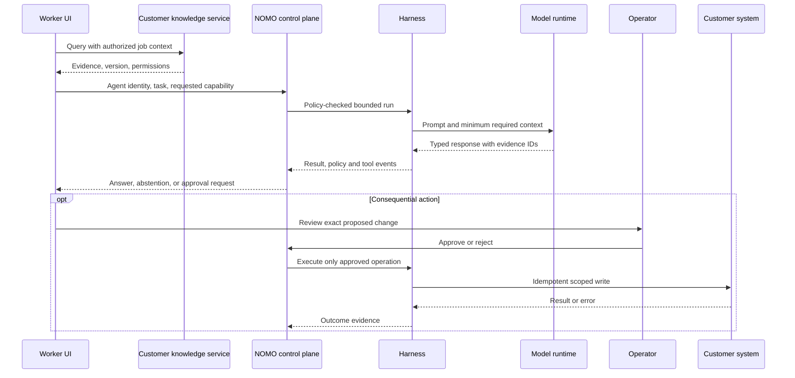

# NOMO x YC: architecture and data boundaries

> **State:** target architecture hypothesis. Audit current NOMO interfaces and release gates before implementation or customer claims. The founder prefers local processing, but has asked us to choose a market-fit boundary rather than assume full air-gap.

## Product boundary

Build a workflow application that uses NOMO for control and evidence. Do not add a second general-purpose agent framework or duplicate identity, policy, approval, and ledger contracts. The user-facing application owns workflow state and source references. A customer-controlled knowledge service owns ingestion and retrieval. NOMO owns which agent can invoke which operation, under what scope and approval, and records the operation outcome.

## Request flow

## Data classes

| Class | Examples | Default handling |
|---|---|---|
| Public | Published manuals, public policy pages | May use approved external retrieval. Preserve source URL and timestamp. |
| Internal | SOPs, product notes, process descriptions | Tenant-scoped storage and access. Do not send to an external model unless the customer configuration allows it. |
| Confidential | Customer files, invoices, claim details, employee records | Minimize, encrypt in transit and at rest, restrict retrieval by user and workflow. Prefer customer-controlled inference when required. |
| Restricted | Credentials, health, payment, legal secrets, special category data | Exclude by default. Handle only after legal, security, retention, and deployment review for a defined workflow. |

## Deployment modes

### Deployment decision for the first validated workflow

Do not select a deployment mode before a buyer states the relevant data boundary. First map the system of record, source content, prompt and output handling, model inference, retention, training, telemetry, support access, metadata, storage location, and network egress. Then compare approved API, customer cloud/VPC, local inference, on-premises, and disconnected options against that requirement and their total deployment and support cost. No mode is the default until discovery and a reproducible data-flow review support it.

Keep the NOMO control plane separate from the data plane. It may receive policy version, agent identity, approval state, operation status, and integrity metadata only when the customer approves that path. It must not receive prompts, retrieved passages, files, or model outputs by default. If the buyer disallows even this metadata egress, use a disconnected control profile with manually signed policy and software updates.

This is a product hypothesis, not yet a customer requirement. First validate the buyer's exact boundary and compare lifecycle costs. Eurostat reports that 52.7% of surveyed EU enterprises with at least 10 employees or self-employed persons used paid cloud services in 2025. The 58.2% figure for finance/accounting software is a share of enterprises already using paid cloud services, not all enterprises. Neither figure establishes willingness to run a private model or buy an air-gapped system. Do not turn “local” into an expensive hard requirement until a buyer confirms it.

1. **Managed cloud, approved API:** the fastest pilot if buyer accepts the provider's current terms and data path. “No model training” is not equivalent to zero retention or zero egress.
2. **Customer VPC or private cloud:** customer controls network, storage, identity, and potentially model access. Still requires a provider and telemetry review.
3. **Customer on-premises or managed node:** recommended first sensitive-data path to test. Customer-hosted inference and storage add hardware, updates, observability, backup, and support costs.
4. **Disconnected / air-gapped:** no internet egress from the workload environment. This is a later option only if a buyer requires and funds it. It needs offline licensing, signed updates, model and dependency inventory, local observability, secure model distribution, support procedure, and hardware budget.

Make the deployment mode and allowed data classes a per-tenant policy. Never silently fall back from a local model to a cloud model. Any cloud model route must be separately enabled for an explicitly approved data class.

## Egress contract

For every deployment mode, publish and test an egress matrix covering: prompts, retrieved passages, files, embeddings, model weights, telemetry, logs, crash reports, identity, license checks, update checks, support bundles, and backups. A setting called “local” is not evidence. Capture network tests and service configuration for each release.

## NOMO ledger boundary

Record the minimum needed to prove authorization and outcome: principal, agent identity, policy version, capability, approval reference, resource identifier, result status, timestamp, and integrity metadata. Do not place full prompts, retrieved text, API keys, personal data, or model chain-of-thought in the ledger. Use short-lived references to customer-controlled evidence where necessary.

## Action safety

- Read-only default for first release.
- Typed input and output contracts for each tool.
- Explicit tenant, user, resource, and operation scope.
- Human approval bound to the exact operation and payload hash.
- Idempotency key and duplicate-write protection.
- Revalidation before execution if policy or source version changes.
- Clear reject, timeout, retry, rollback, and partial-failure states.
- No learning process can grant permission or bypass policy.

## Acceptance checks

- Tenant isolation verified by negative tests.
- Egress test confirms configured model route and denies unapproved endpoints.
- Source deletion removes documents, chunks, embeddings, caches, and derived artifacts within declared limits.
- Every answer can resolve evidence to an approved version and location.
- Missing or conflicting evidence produces a typed abstention or escalation.
- A user cannot turn a draft into a write by changing client-side state.
- Logs and exports are reviewed for prompt leakage and secrets.
- Restore and revocation behavior are demonstrated in the target deployment mode.

