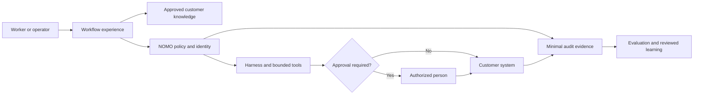

# NOMO x YC Winter 2027: founder thesis

> **State:** working thesis for founder review. No customer segment or product is validated or selected. Evidence checked 2026-10-27.

## Decision in one page

Test a product that helps a small team turn its approved company knowledge into bounded, repeatable AI work, with local or customer-controlled inference when required. NOMO supplies agent identity, policy, approvals, execution records, and evaluation hooks. The first wedge is a single measurable workflow chosen through customer evidence.

The core product is not “a private chatbot.” It is an operational loop:

1. Find the right approved source and context.
2. Produce a bounded answer, draft, or proposed action.
3. Show evidence and uncertainty.
4. Route consequential actions through policy and human approval.
5. Record the decision and outcome without retaining unnecessary sensitive content.
6. Improve retrieval and workflow quality from reviewed corrections.

The YC RFS items most closely aligned are **The $15-an-Hour Expert**, **AI for the Air-Gapped Economy**, and **Own Your Intelligence**. Treat these as adjacent opportunity signals, not three product requirements to build at once. The first item gives the user value proposition; the second is a deployment constraint for a subset of customers; the third is a possible later ownership and adaptation layer.

## What is known, inferred, and unproven

| Claim | Type | Evidence or test |
|---|---|---|
| YC is asking for AI that lets non-experts perform expert-gated work. | Public fact | YC Winter 2027 RFS. It is a request for founders, not market validation. |
| Eurostat reports 20.0% AI use in its 2025 ICT survey population; ČSÚ reports 17.6% for Czech enterprises with 10+ employees. | Public fact | Eurostat covers 10+ employees or self-employed persons in NACE C–J, L–N and group 95.1, excluding micro-enterprises and financial/insurance activities. Neither figure measures demand or willingness to buy NOMO. |
| Some organizations dislike their data being used to train external models. | Public fact | UKBDS 2026: 73% reported discomfort with external-model training. This does not show refusal of API inference or prove demand for local models. |
| AI remains weakly integrated into many business processes. | Public fact with scope limits | UKBDS describes integration as limited; McKinsey reports broad regular use but limited scaling. Survey samples and definitions differ. |
| A workflow product can outperform a generic assistant in a narrow task. | Hypothesis | Compare against current workflow and incumbent AI using customer-provided cases. |
| NOMO can make private workflows auditable and permission-bounded. | Technical hypothesis | Audit current NOMO behavior and prove on a reproducible demo before making customer claims. |
| A particular vertical will pay for local inference. | Unproven | Find a buyer with an explicit data boundary, workflow owner, budget, and dated pilot. |

## Opportunity portfolio

### Wedge A: expert workbench for one role

Turn one internal procedure into guided work: gather inputs, retrieve approved evidence, draft a result, validate required fields, and prepare the next action. Start read-only. Candidate workflows include complex claims intake, accounting exception handling, equipment service documentation, and regulated document processing. Keep them unranked until comparable customer evidence shows a repeat task, operator, expert, permission path, measurable burden, and buyer-backed next step.

### Wedge B: secure company knowledge and workflow control

Connect existing repositories and business tools to a governed agent. It may run in a customer VPC, on-premises, or fully disconnected only where evidence requires that deployment. “Private” must have a testable definition: data locations, network egress, model runtime, telemetry, backups, logs, updates, and support access.

### Wedge C: customer-owned intelligence

After one workflow is proven, offer customer-specific retrieval, reviewed memory, adapters, or fine-tunes where they materially improve an outcome. Do not start by training a foundation model. Better source governance and evaluations may solve the first problem at much lower cost.

## Why NOMO may matter

NOMO's current direction includes fleet control, an execution ledger, and a Harness. These are useful only if the workflow crosses multiple agents or systems and the buyer values the control. They are not a substitute for customer access, high-quality sources, a useful user experience, or a paid outcome. Current repository specifications and release gates are authoritative; this paper does not assert that every described runtime capability is shipped.

## First discovery cycle

Use the ten-working-day Phase 0 in the integrated roadmap, with a dated decision review. Request the warm owner/CFO interview without assuming a finance workflow; compare at least three plausible workflow/buyer hypotheses and label each item as observed evidence or assumption with source and confidence. If evidence is too thin, report that result and carry the hypotheses forward rather than ranking them. Audit only NOMO, Papayai, and repositories created in the month before the research cutoff. After a specific repeated job emerges, recruit the relevant operator and expert, obtain permission for cases, and compare the existing process with the simplest approved concierge test. The paid pilot commitment follows successful evaluation; do not treat indicative pilot terms as demand.

## Kill or pivot conditions

- A focused cohort cannot reproduce the same recent job and workaround with enough evidence to justify a further test; report the actual sample and uncertainty rather than treating a fixed interview count as proof.
- No owner will provide authorized representative cases.
- The buyer and domain expert cannot define a measurable, bounded outcome in a timebox justified by the workflow.
- Buyers already solve the job with an accepted incumbent and will not pay to improve it.
- Local execution adds cost or latency without changing purchase intent.
- The workflow requires unsafe autonomous decisions before value appears.
- NOMO adds no measurable trust, control, integration, or operating advantage.

## References

- YC Winter 2027 Requests for Startups: https://www.ycombinator.com/rfs
- Eurostat, enterprises using AI technologies, 2025: https://ec.europa.eu/eurostat/web/products-eurostat-news/w/ddn-20251211-2
- Czech Statistical Office, ICT in enterprises: https://csu.gov.cz/ict-in-enterprises
- Eurostat, European enterprises by size: https://ec.europa.eu/eurostat/documents/15216629/23732306/KS-01-26-010-EN-N.pdf
- UK Business Data Survey 2026: https://www.gov.uk/government/statistics/uk-business-data-survey-2026/uk-business-data-survey-2026
- McKinsey, State of AI 2025: https://www.mckinsey.com/capabilities/quantumblack/our-insights/the-state-of-ai-2025
- Menlo Ventures, 2025 State of Generative AI in the Enterprise: https://menlovc.com/perspective/2025-the-state-of-generative-ai-in-the-enterprise/
- NIST AI Risk Management Framework: https://www.nist.gov/itl/ai-risk-management-framework

