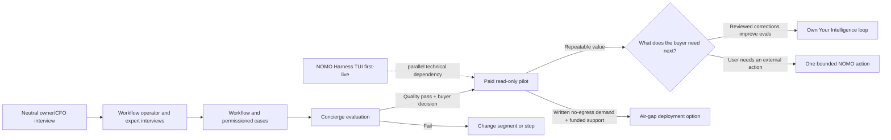

<!-- gstack-autoplan-scope: --ui --developer-tool -->
<!-- /autoplan restore point: "/Users/dawe/Developer/Claude-Projects/NOMO/.gstack/tmp/autoplan-full/main-autoplan-restore-20261027.md" -->
<!-- /autoplan restore point: "/Users/dawe/Developer/Claude-Projects/NOMO/.gstack/tmp/autoplan/main-autoplan-restore-20261027.md" -->
# NOMO x YC: integrated startup and product roadmap

> Planning date: 2026-10-27. Relative periods begin only after the named exit gate. No target date is a commitment. Discovery can run while NOMO completes its own first-live release.

## Problem statement

NOMO could become the control, policy, approval, and evidence layer for a product that helps a less-specialized worker complete one repeated, expert-gated company task. The first outcome hypothesis is **The $15-an-Hour Expert**; **Own Your Intelligence** and **AI for the Air-Gapped Economy** are later capabilities gated by customer evidence. The first market remains open. Czechia is the first discovery geography because the founder reports one reachable SME owner/CFO, not because finance is selected. No customer interview, workflow, sample permission, paid pilot, or demand has been confirmed. NOMO first-live work remains its own engineering stream and does not validate demand.

## Implementation plan

### Order of work

Keep NOMO Harness/TUI/first-live as a separate engineering stream. Start customer discovery now. Begin customer-facing product code only after the workflow, buyer, operator, expert, approved evidence, and paid-pilot path are identified. A NOMO first-live release is a dependency for product integration where applicable, but it does not validate market demand.

### Phase 0: discovery while NOMO ships

**Timebox:** ten working days from first outreach, with a dated decision review. If the first contact is unavailable, try a second reachable role/company during the same window. Extend only when a concrete introduction or evidence artifact is scheduled; otherwise revise the candidate set or stop.

**Work:** request the reachable owner/CFO interview, reconstruct one recent costly or expert-gated company task without leading toward finance, get an operator introduction if a concrete workflow emerges, inspect current tools, and establish whether a permitted case set could exist. Turn the first case into an unranked shortlist of at least three plausible job/buyer hypotheses; compare them on recent case evidence, repeat frequency, current burden, buyer/operator access, source permission, budget route, and incumbent gap before choosing which one deserves a focused cohort. Use the first interview as a hypothesis source, not a segment decision. Audit only NOMO, Papayai, and repositories created in the last month for in-scope reusable assets. Keep using no sensitive customer data.

**Deliverables:** interview record, workflow map, buyer/user map, data boundary questionnaire, updated segment scorecard, and a comparison memo covering at least three plausible workflow/buyer hypotheses (which may come from different companies or roles). Record the source and confidence of every comparison item; label observed facts separately from assumptions. If only one interview is available, say the comparison is inconclusive and carry hypotheses forward rather than choosing a winner from unsupported scores.

**Exit:** one specific recent task, named operator and expert, repeat frequency, painful measurable baseline, source of truth, current-system gap, credible permission path, and a comparison against at least two plausible alternatives using the same evidence criteria. Record one buyer-valued reason NOMO could win against existing workflow software, internal tools, general AI, or expert services; “agentic,” “ledger,” and “local” are not buyer value by themselves.

**Stop or redirect:** contact cannot identify a recent repeated task or introduce an operator; incumbent solves the difficult cases; no repeat rate; no lawful data path. Reopen the search with another reachable company or role instead of assuming finance.

### Phase 1: problem and data validation

**Timebox:** up to ten working days after the first interview; review the decision on the final day. If access or an authorized sample is not materializing, change the reachable candidate or stop rather than extending discovery without a new hypothesis.

**Work:** only after comparing the shortlist, select the strongest evidenced job for focused validation and interview up to eight people who perform, supervise, or expert-review that same job. Test repeatability, severity, ownership, purchasing path, data constraints, and competing approaches. The 5-of-8 threshold is a founder-set screening heuristic, not statistically representative and not market validation. Define a domain rubric with an expert. Obtain written permission for an adequate minimized/de-identified sample before a concierge run; sample size and gates must fit the actual decision and expert rubric.

**Deliverables:** evidence-backed product brief, representative cases, rubric, security/data-flow draft, baseline protocol, target account criteria.

**Exit:** same task and gap recur across qualified accounts; real users and buyers agree it matters; a defensible evaluation set and expert exist; the buyer confirms a measurable value threshold and accepts a dated conditional-pilot proposal review. Before moving to Phase 2, record indicative fee/payment timing, buyer-confirmed value hurdle, time-to-value target, maximum delivery/support effort, and stop conditions in an evaluation agreement or conditional proposal. These are success criteria and indicative terms, not a binding paid-pilot commitment. Set values from observed case economics and buyer input rather than inventing a universal price. A positive discussion alone does not pass.

### Phase 2: concierge test

**Timebox:** one to two weeks after sample approval, with one dated result review. If the authorized sample or expert review cannot be completed within the agreed window, do not keep extending the prototype; return to the buyer with the blocker and decide whether the opportunity justifies another funded iteration.

**Work:** run a customer- and expert-approved number of representative cases. Thirty to fifty is an initial planning range, not a universal statistical requirement. Use the simplest approved tooling. Compare on the same cases against the incumbent workflow, existing vertical software, an internal expert or outsourced service, and a general-purpose AI route only if the buyer approves that data path. Log quality, abstention, reviewer time, failure, support, founder delivery time, and implementation effort. No production integration or automatic writes.

**Deliverables:** blind-reviewed evaluation report, unit-economics worksheet, data-handling record, paid pilot proposal.

**Exit:** customer-agreed quality gates pass, critical unsupported guidance is zero in evaluated cases, an alternative does not already deliver equal or better value at lower total cost, workflow value includes review time, and buyer signs/pays for a pilot with a named budget, time-to-value target, and delivery/support-cost ceiling. Record the founder-set rule **"paid-pilot gross margin >= 0%"**: this is the arithmetic break-even point under `(revenue − fully loaded direct delivery cost) / revenue`, not a market benchmark. Include implementation, infrastructure, model usage, hardware amortization, expert support, and founder/operator time at the pre-approved role rate. Before pricing or reviewing the first pilot, date and record one labor-rate method: preferably loaded compensation (annual compensation plus employer taxes and benefits divided by documented productive hours), or, if unavailable, a fixed founder-approved planning rate card by role with rationale. Hold rates constant across the experiment; never select or change them after seeing results. If rates must change, close and preserve the old series, then start a separately labeled one. Count a deployment only when the buyer entity accepted the deliverable and payment was collected. Any validation subsidy below break-even requires a separate founder-approved cap and is not evidence of viable economics. A buyer's acceptable price and cost ceiling remain customer-specific. A positive discussion alone does not pass.

### Phase 3: narrow paid MVP

**Start condition:** NOMO first-live capabilities required for the chosen implementation are verified in code and deployment, and customer has funded the pilot. Reuse only real released capabilities.

**Build:** one task UI, tenant-scoped approved-source retrieval, source versioning, typed result states, clear citations, missing-information and conflict handling, human escalation, access controls, deletion, eval replay, and operator-visible audit references. Read-only by default. No general chat, broad connector marketplace, model training, or fleet control unless the pilot requires it.

**Exit:** pilot acceptance, repeated usage, measured end-to-end value, bounded support, and a positive repeat-delivery model. Calculate gross margin as `(revenue − fully loaded direct delivery cost) / revenue`; include implementation, model/infrastructure, hardware amortization, expert support, and founder/operator time at a recorded internal rate. Before general availability, founders set and record a numeric gross-margin target from measured pilot costs and buyer-accepted pricing. Do not call the opportunity scalable until three consecutive paid deployments to **three distinct buyer organizations** meet that target. Repeated deployments or subsidiaries sharing one budget owner count as one organization; track expansion separately. This is a founder screening rule, not statistical proof. If the three-account sample does not meet the target, reduce delivery cost, change price/scope, or stop.

### Phase 4: controlled actions and Own Your Intelligence

**Work:** add one reversible action only if users need it and customer explicitly approves it. Enforce least privilege, exact payload approval, idempotence, audit reference, error recovery, rollback, and a kill switch. Build the customer-owned improvement loop from source changes, expert correction, versioned evaluation, and replay.

**Exit:** correction loop measurably improves held-out cases without weakening safety or tenant boundaries. Fine-tuning remains optional and evidence-gated.

### Phase 5: deployment expansion

Offer cloud inference, customer-controlled cloud, on-prem, and air-gapped modes as distinct packages with explicit data-flow statements. Do not advertise an air-gap until offline install, update, signing, revocation, backups, observability, incident response, and acceptance tests work.

**Air-gap entry gate:** written buyer restriction, named security approver, funded paid pilot, compatible hardware, install owner, support budget, update window, and agreed network verification.

### Critical path and parallel work

| Stream | Can run now | Must wait |
|---|---|---|
| Customer discovery | Yes | None |
| Market/repository audit | Yes, scope-limited | Never treat code as customer demand |
| Concierge evaluation | After permissioned cases and expert rubric | Sample permissions and workflow |
| Customer product implementation | No | Paid-pilot scope and data boundary |
| NOMO integration | Verify Harness/TUI/first-live surface as it ships | Use production claims only after release evidence |
| Own Your Intelligence | Define measures now | Repeat usage and reviewed corrections |
| Air-gap engineering | Buyer interviews only | Named written no-egress requirement and budget |

### Weekly founder cadence

Each week, review: interviews held, workflow evidence, permissions, paid commitments, evaluation quality, total time per successful case, incidents, delivery cost, and decision gates. Keep a decision log with date, evidence, assumption changed, owner, and next experiment. Never turn activity counts into demand claims.

### Private founder page

Maintain `/nomoyc` as an unlinked, noindex, password-protected, read-only founder workspace. Make the first viewport a decision panel with current stage, next action, owner, last-reviewed date, missing evidence, and next pass/stop gate. The next action is a neutral request for one recent task walkthrough; the warm owner/CFO contact is not yet asked. Keep the three YC ideas in a compact sequence, and collapse the full 11-item RFS and deep research behind progressive disclosure.

The page is a snapshot, not a live tracker. The canonical source is the NOMO `docs/strategy` Markdown set. Generate the encrypted document library from that source with stable document IDs, title, status, reviewed date, and content digest; fail the packaging step if the generated manifest does not match the source files. Search document titles and content. Show a visible session-restoration state before auth resolves and a distinct authenticated-content-loading state before revealing the page. Distinguish content-ready, empty-library, empty-search-results, expired-session, login-error, retryable-service-error, and partial-content-error states. Do not call the library empty until its manifest has loaded. On partial content failure, preserve the content that did load, name what is missing, and offer retry; an API outage must not be presented as a bad password. Add a direct source link, year, population, and denominator to every chart, plus a readable textual equivalent. Show the roadmap as a responsive decision tree: fail/change/stop after evaluation, Own Your Intelligence only after repeat use and reviewed corrections, one bounded action only if users need it, and air-gap only after a written no-egress requirement and funded support. Display NOMO first-live as a parallel technical prerequisite, not as a customer-market milestone.

**Developer path and contract:** prerequisites are Node.js 22+ and the Vercel CLI. A first-time contributor runs `vercel login`, `vercel link` (select the existing DavidSak project), and `vercel env pull .env.local`; `.env.local` is Git-ignored and stays private. If Vercel hides `NOMOYC_CONTENT_KEY_V2`, restore it from the protected local key file with `node scripts/sync-nomoyc-local-key.mjs --key-file ~/.config/nomoyc/content-key-v2 --env-file .env.local`. If Vercel hides `NOMOYC_PASSWORD`, enter the authorized value into `.env.local` using a trusted local editor or secret manager; never put it in a command argument, shell history, or output. Use the value-free presence check in the developer runbook; it rejects empty and masked placeholder values without printing the secret. From the DavidSak checkout, run `node scripts/sync-nomoyc-content.mjs --source ../NOMO/docs/strategy --key-file ~/.config/nomoyc/content-key-v2 --check`; expected result is `OK: N documents match encrypted manifest`. Exit 1 is a safe packaging failure (`NOMOYC_MANIFEST_MISMATCH`): stderr lists only missing, extra, or changed document paths/IDs and the corrective command, `... --write`; never print document text or the key. Then run `vercel dev` and open `http://localhost:3000/nomoyc`. The login UI shows safe API detail and request ID on failure; after one failed read retry, contact the page owner with that ID. The API has GET/HEAD for the authenticated read-only snapshot, POST login, and POST logout. Errors use RFC 9457 `application/problem+json`, stable `code`, `doc_anchor`, HTTP status, `api_version`, `request_id`/`X-Request-Id`, and a bounded `retry` instruction. Error bodies include environment variable names only, never values. Reads have no customer-data side effects; the server may increment its rate-limit counter. Login/logout may set or clear the session cookie. The UI retries a read once at most; it never retries a state-changing operation automatically. If a state-changing result is uncertain, reconcile session state before retrying. Unexpected failures are correlated by request ID; internal logs may retain a redacted trace, while responses omit traces, nested causes, cookies, and credential-bearing URLs.

Keep strategy content behind the authenticated API and encrypted payload; do not place a navigation link, button, or teaser on public pages. Page claims and graphics must use the same current decisions and evidence labels as the canonical Markdown. The shared password is a temporary gate and does not prove individual founder identity; assign an owner and rotate/revoke it when membership changes, and use individual identity if named-person access is mandatory. Before deployment verify login/logout and expiry, anonymous denial, bad origin, body-size rejection, rate-limit/`Retry-After`, ciphertext failure/redaction, cache/robot headers, mobile readability, manifest sync, and absence of public site links. Use `scripts/verify-nomoyc-api.mjs` for the isolated API failure-boundary assertions and the developer runbook for expected output.

Before relying on this encrypted founder snapshot, store its 32-byte key in a restricted secure note in the founders' approved password manager or secrets vault. Name an owner, restrict access to named founders, and test restoring the key with the encrypted-manifest `--check`. Never commit, email, print, or paste the key; see the developer runbook for the restore steps.

For local `vercel dev`, if `vercel env pull` masks `AUTH_SECRET`, use the runbook to create a separate local-only value in ignored `.env.local`; do not rotate or replace the shared production secret. The runbook checks all three required local variables without displaying values.

## Review record

GStack review is in progress. This section records phase findings, decisions, and accepted obligations. A review phase is not complete until its gstack checklist and reviewer input are recorded below.

### CEO review — native reviewer, 2026-10-27

Coverage: one native GStack reviewer; the configured outside reviewer was unavailable and was not launched. Findings are therefore native-only and not cross-model validated.

| Finding | Disposition |
|---|---|
| Avoid selecting a segment from one reachable account | Added a ten-day discovery checkpoint and comparison across at least three workflow/buyer hypotheses before a focused cohort. |
| Make paid-pilot economics concrete before implementation | Require a buyer-confirmed value hurdle, written fee/payment timing, time-to-value target, and delivery/support ceiling before Phase 2. |
| Prevent indefinite discovery | Added dated review points and explicit stop/revise outcomes to discovery and validation phases. |
| Prove why NOMO wins against alternatives | Added a buyer-valued comparative advantage criterion and same-case comparison against incumbent, vertical software, expert service, and approved general AI. |

Six-month regret scenario: a paid, bespoke pilot that has no repeatable economics or durable buyer-valued advantage. The new gates are intended to catch this before broader implementation.

### CEO follow-up — native reviewer, 2026-10-27

Coverage: one native reviewer; outside review remains unavailable and was not launched.

| Finding | Disposition |
|---|---|
| Hypothesis comparison could imply stronger evidence than available | Require source/confidence per comparison item, distinguish observations from assumptions, and allow an inconclusive result. |
| Written pilot offer could sound binding before evaluation | Reframed as indicative terms in a conditional proposal/evaluation agreement; binding paid commitment follows successful Phase 2 results. |

### CEO final pass — native reviewer, 2026-10-27

Coverage: one native reviewer; no external reviewer was configured or launched. Both findings were incorporated below.

| Finding | Disposition |
|---|---|
| Comparison could overstate thin evidence | Every comparison item now requires source/confidence and an observed-vs-assumption label; the plan permits an inconclusive result. |
| A written offer could imply an early commitment | Phase 1 now uses a conditional proposal/evaluation agreement; binding fee and pilot commitment follow successful Phase 2 evaluation. |

### Design review — native reviewer, 2026-10-27

Coverage: native design-plan review; no external reviewer was configured or launched. Six findings were returned; the applicable plan obligations are recorded in the Private founder page section. The route is a read-only snapshot, not a live tracker.

### Design follow-up — native reviewer, 2026-10-27

Coverage: native follow-up review; no external reviewer was configured or launched. The remaining state-model finding is addressed by distinguishing content-ready, empty-library, empty-search, and partial-content failures while retaining loaded content and providing retry.

### Design state review — native reviewer, 2026-10-27

Coverage: native reviewer; no external reviewer was configured or launched. A visible session-restoration state and a distinct authenticated-content-loading state are required; the page must keep private content hidden until authentication and payload loading succeed.

### DX review — native reviewer, 2026-10-27

Coverage: native DX review; external review was unavailable because no external reviewer is configured. Seven findings were returned and addressed in the developer runbook, page, API, and encrypted-manifest tooling.

| Finding | Disposition |
|---|---|
| Login, expiry, service, and partial-content errors lacked actionable recovery | The API returns safe detail and a bounded retry instruction. The page displays the correlation ID; after one failed read retry, the user contacts the page owner with that ID. |
| Retry bounds and side effects were unspecified | The runbook distinguishes read-rate counters, session-cookie writes, and logout clears. The UI does not auto-repeat state-changing requests; a read has one explicit retry. |
| Error context and trace handling were unspecified | RFC 9457 response includes stable code, API version, doc anchor, request ID, and variable names without values. Unexpected failures are logged with request ID and redacted secrets; response bodies omit traces and nested causes. |
| Manifest mismatch gave no path to repair | The sync command exits non-zero with `NOMOYC_MANIFEST_MISMATCH`, lists only mismatching document IDs/paths, and prints the exact `--write` correction command. |
| Error codes and protocol were underspecified | API responses use `application/problem+json` and stable codes for configuration, rate-limit, session, password, method, origin, size, encrypted-content, and unexpected failures. |
| Local setup and first-success path were missing | Added a copy-paste source check, local preview command, prerequisites, expected output, and private-key handling to the developer runbook. |

The sync tool's `--check` was verified against the current encrypted snapshot after migration. The review is native-only; do not treat it as external or cross-model approval.
