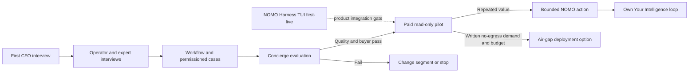

# NOMO x YC: integrated startup and product roadmap

> Planning date: 2026-10-27. Relative periods begin only after the named exit gate. No target date is a commitment. Discovery can run while NOMO completes its own first-live release.

## Order of work

Keep NOMO Harness/TUI/first-live as a separate engineering stream. Start customer discovery now. Begin customer-facing product code only after the workflow, buyer, operator, expert, approved evidence, and paid-pilot path are identified. A NOMO first-live release is a dependency for product integration where applicable, but it does not validate market demand.

## Phase 0: discovery while NOMO ships

**Work:** request the CFO interview, reconstruct one recent task, get an operator introduction, inspect current tools, and establish whether a permitted case set could exist. Audit only NOMO, Papayai, and repositories created in the last month for in-scope reusable assets. Keep using no sensitive customer data.

**Deliverables:** interview record, workflow map, buyer/user map, data boundary questionnaire, updated segment scorecard.

**Exit:** one specific recent task, named operator and expert, repeat frequency, painful measurable baseline, source of truth, current-system gap, and a credible permission path.

**Stop:** CFO cannot name a task or introduce an operator; incumbent solves it; no repeat rate; no lawful data path.

## Phase 1: problem and data validation

**Work:** interview up to eight similar qualified roles; test task repeatability, severity, ownership, purchasing path, and data constraints. The 5-of-8 threshold is a screening heuristic only. Define a domain rubric with an expert. Obtain written permission for 10 to 20 minimized/de-identified examples before the concierge run.

**Deliverables:** evidence-backed product brief, representative cases, rubric, security/data-flow draft, baseline protocol, target account criteria.

**Exit:** same task and gap recur; real user and buyer agree it matters; a defensible evaluation set and expert exist; buyer accepts a paid-pilot discussion.

## Phase 2: concierge test

**Work:** run 30 to 50 representative cases if customer permissions and volume support it. Use the simplest approved tooling. Compare with incumbent process; log quality, abstention, reviewer time, failure, and support. No production integration or automatic writes.

**Deliverables:** blind-reviewed evaluation report, unit-economics worksheet, data-handling record, paid pilot proposal.

**Exit:** customer-agreed quality gates pass, critical unsupported guidance is zero in evaluated cases, workflow value includes review time, and buyer signs/pays for a pilot.

## Phase 3: narrow paid MVP

**Start condition:** NOMO first-live capabilities required for the chosen implementation are verified in code and deployment, and customer has funded the pilot. Reuse only real released capabilities.

**Build:** one task UI, tenant-scoped approved-source retrieval, source versioning, typed result states, clear citations, missing-information and conflict handling, human escalation, access controls, deletion, eval replay, and operator-visible audit references. Read-only by default. No general chat, broad connector marketplace, model training, or fleet control unless the pilot requires it.

**Exit:** pilot acceptance, repeated usage, measured end-to-end value, bounded support, and credible gross margin.

## Phase 4: controlled actions and Own Your Intelligence

**Work:** add one reversible action only if users need it and customer explicitly approves it. Enforce least privilege, exact payload approval, idempotence, audit reference, error recovery, rollback, and a kill switch. Build the customer-owned improvement loop from source changes, expert correction, versioned evaluation, and replay.

**Exit:** correction loop measurably improves held-out cases without weakening safety or tenant boundaries. Fine-tuning remains optional and evidence-gated.

## Phase 5: deployment expansion

Offer cloud inference, customer-controlled cloud, on-prem, and air-gapped modes as distinct packages with explicit data-flow statements. Do not advertise an air-gap until offline install, update, signing, revocation, backups, observability, incident response, and acceptance tests work.

**Air-gap entry gate:** written buyer restriction, named security approver, funded paid pilot, compatible hardware, install owner, support budget, update window, and agreed network verification.

## Critical path and parallel work

| Stream | Can run now | Must wait |
|---|---|---|
| Customer discovery | Yes | None |
| Market/repository audit | Yes, scope-limited | Never treat code as customer demand |
| Concierge evaluation | After permissioned cases and expert rubric | Sample permissions and workflow |
| Customer product implementation | No | Paid-pilot scope and data boundary |
| NOMO integration | Verify Harness/TUI/first-live surface as it ships | Use production claims only after release evidence |
| Own Your Intelligence | Define measures now | Repeat usage and reviewed corrections |
| Air-gap engineering | Buyer interviews only | Named written no-egress requirement and budget |

## Weekly founder cadence

Each week, review: interviews held, workflow evidence, permissions, paid commitments, evaluation quality, total time per successful case, incidents, delivery cost, and decision gates. Keep a decision log with date, evidence, assumption changed, owner, and next experiment. Never turn activity counts into demand claims.
