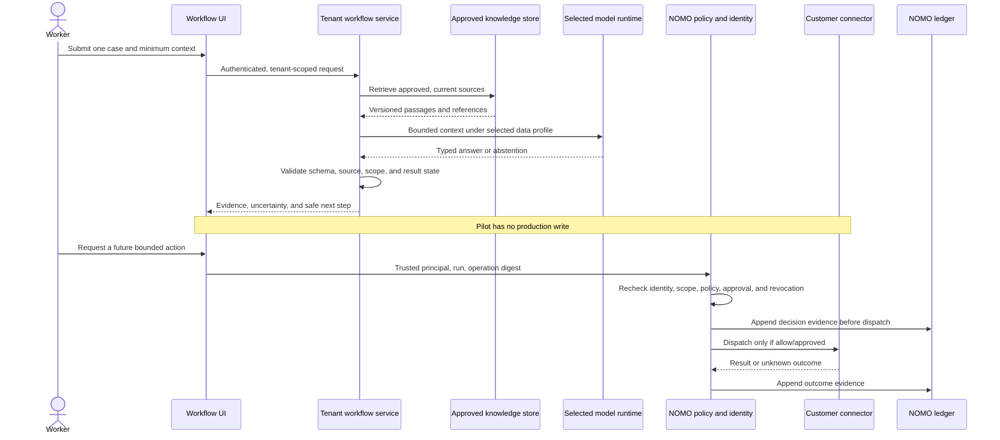

# NOMO x YC: technical integration and implementation plan

> Status: proposed sequence after the coding-agent Harness and TUI reach their own first-live release gate. This plan is documentation only. It does not claim the release gate is complete or authorize broad workflow code now.

## Architecture decision

Keep the first customer workflow separate from the coding-agent Harness interface. Reuse proven NOMO identity, policy, approval, operation, and ledger contracts where they directly govern a customer action. Build a separate customer data plane for knowledge, cases, prompts, and evaluations. Use a mobile-first web surface for the worker. Use the NOMO TUI for NOMO operators, diagnostics, and verified ledgers, not as the worker application.

The first pilot should be read-only. Do not require the fleet control plane, multiple agents, or every connector to prove a single workflow. If a user can test the task through a manual concierge and exported draft, do that before adding a service boundary.

## Verified reusable building blocks

These source references were identified in the current NOMO working tree. Verify exact current source and tests at implementation time because the tree is actively changing.

| Existing area | Candidate reuse | Boundary |
|---|---|---|
| `packages/workbench/src/index.ts` | Workbench session, policy decisions, approvals, and verified operation path | Built for coding-agent work today. Do not assume it is a tenant-isolated business workflow engine. |
| `packages/workbench/src/harness-runtime.ts` | Deterministic gate, one model review, schema validation, and signed-chain application | Code-learning flow is not customer knowledge or answer evaluation. Reuse only if the business action contract matches. |
| `packages/workbench/src/learned-harness.ts` | Evidence-backed learning proposal and provenance requirements | Keep learning inert until authorized review. Do not infer source ingestion or domain expertise. |
| `packages/workbench/src/harness-scores.ts` | Scoreboards and evaluation patterns | Extend only after defining a separate customer case schema and privacy boundary. |
| `packages/ledger/` | Append/read/verify decision and operation evidence | Do not store customer prompts, documents, answers, or retrieved passages in ledger records. |
| `packages/runtime/src/journal.ts` | Typed operation lifecycle and unknown outcome handling | Use only for actual operations with stable operation IDs and connector semantics. |
| `packages/cli/src/tui/` | Operator inspection and policy support | TUI is not the worker-facing client. Complete and verify live view gates before claims. |
| `apps/control-plane/` and fleet specs | Principal, workspace, agent, run, remote events, and approval design | Specs and fixtures do not equal production fleet, OAuth, revocation, or multi-tenant readiness. |

## Proposed request path

## Data separation

| Data class | Store | Ledger treatment | Default retention question |
|---|---|---|---|
| Original customer document | Customer-approved object store or local filesystem | Reference, digest, source version only if contract permits | Owner, expiry, deletion and backup behavior |
| Retrieved passage | Transient request context or customer-controlled cache | Never store passage text | Cache duration and deletion |
| Prompt and model output | Customer data plane for the shortest needed period | Never store full text in ledger | User access and retention policy |
| Case evaluation example | Tenant-scoped evaluation store | Case ID and evaluation metadata only if permitted | Customer-specific retention and export |
| Identity, scope, policy decision | NOMO control path | Append minimum decision and version references | Audit retention and operator visibility |
| Secret or provider credential | Customer secret manager / approved runtime boundary | Never store or log | Rotation and revocation |
| Aggregate metrics | Tenant-scoped metrics | No payload content | De-identification and sharing approval |

## Inference profiles

Resolve the data profile per buyer, not through a global "local first" claim:

1. **Approved managed API:** only when buyer permits the named provider, region, retention, and contract terms for that data class.
2. **Customer-controlled cloud or VPC:** still cloud processing; state support access and control-plane metadata explicitly.
3. **On-premises:** customer hosts application, data, and model; NOMO inherits upgrade, hardware, backup, and support responsibilities.
4. **Air-gapped:** no external network path. Requires offline model and dependency delivery, signed updates, local observability, recovery, and an egress test.

The system must never fall back from a denied local route to a cloud route. A route switch requires an explicit customer administrator action and a recorded configuration change.

## Implementation work packages after the NOMO first-live gate

### WP-A: integration audit

- Re-read current `docs/CONTEXT.md`, `docs/DECISIONS.md`, the Harness spec, TUI release plan, source code, and tests.
- Mark capability shipped, partial, planned, or absent with file and test evidence.
- Confirm authentication and tenant boundaries before touching customer data.
- Exit: an approved integration map and no conflicting worktree ownership.

### WP-B: customer workflow and data contract

- Implement only after the workflow gate in the product spec passes.
- Define tenant, user, case, source, version, citation, result-state, and evaluation IDs.
- Keep sources and evaluation data outside the ledger.
- Exit: threat model and data-flow review approved; schema versioned; deletion and export tested.

### WP-C: read-only retrieval and answer contract

- Source registry, approval state, version/effective date, content digest, access scope, and exact location.
- Retrieval filters before ranking. Unknown source state fails closed.
- Typed result with answer, missing inputs, conflict, abstention, or escalation.
- Citation validator rejects unresolvable or disallowed source IDs.
- Exit: fixed expert evaluation gates pass; no connector writes are present.

### WP-D: worker surface and operator controls

- Use the smallest existing web stack that already fits the deployment, with no new framework until the project audit selects the host.
- Mobile-first one-task screen, source viewer, feedback, review queue, and exportable draft.
- NOMO operator sees policy, identity, holds, and safe metadata through supported TUI/control-plane paths.
- Exit: user tasks, keyboard/screen-reader basics, loading/error/empty states, and role checks pass.

### WP-E: controlled action, only if the workflow requires it

- Select one reversible, low-impact action in a test workspace.
- Register agent and run identity; bind tenant, connector, resource, tool, arguments, expiry, and policy version.
- Canonicalize the exact operation. Hold approval binds the digest and verified approver.
- Append decision before dispatch. On append failure, dispatch nothing. Record result or explicit unknown outcome. Reconcile unknown outcomes before retry.
- Exit: negative policy tests, hold tests, replay/idempotence tests, revoke tests, ledger verification, rollback, and independent code review pass.

### WP-F: customer-owned improvement, after repeated use

- Add versioned evaluation cases and reviewer-approved corrections.
- Run baseline and candidate model/retrieval versions against the same fixed cases.
- Show outcome delta and cost. Preserve rollback to prior sources/config.
- Exit: measurable quality or cost improvement without policy, permission, or tenant-boundary changes.

### WP-G: offline profile, after paid requirement

- Package exact runtime, models, dependencies, SBOM, signatures, hardware profile, update/rollback, and local support procedure.
- Verify no network egress under realistic blocked-DNS and blocked-route conditions.
- Exit: buyer security owner signs test result, updates and recovery work offline, and support economics are covered.

## Global invariants

- Unknown identity, tenant, policy, source status, model route, revocation, or ledger state fails closed for actions.
- Read-only answer generation cannot mint credentials or broaden tool scopes.
- Learning can change only approved knowledge or model configuration. It cannot change authorization.
- Customer data never becomes training material for another customer.
- No payloads, credentials, prompt text, or chain-of-thought in operational logs or signed ledger.
- No product or privacy claim exceeds a reproducible test.
- The customer is informed when a feature is a draft, a model answer, an expert-reviewed answer, or an executed action.

## Release dependency

The current coding Harness and TUI release remains a separate NOMO gate. Do not state that the customer product depends on every fleet feature. Do require a reliable, supported host, versioned identity/policy/evidence contracts, and an operator method before any write path enters a customer pilot.
