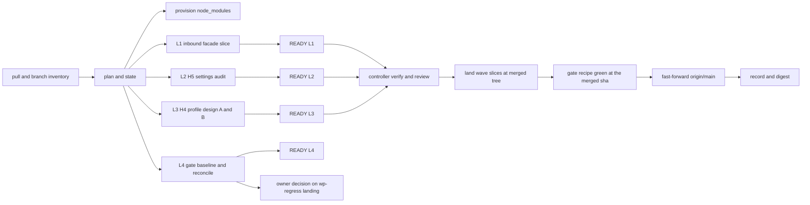

# The wave 1 continuation workstream as a graph (2026-10-29)

This file is the control surface for the current crew wave. It follows the
same convention as the harness workstream graph and extends
`docs/HARNESS-LOOP-PLAN.md` with the present repository state. It is
rewritten at every checkpoint and is the first thing a next session reads.

## Directive

Every lane of this wave ends merged or explicitly deferred, with evidence
that was produced by running the real commands, never by claiming them.

## Node lifecycle per lane

One node, one job. Executors are the controller session or one subagent.

| Node   | Job                                                         | Executor                       | Exit artifact                               |
| ------ | ----------------------------------------------------------- | ------------------------------ | ------------------------------------------- |
| BRIEF  | Goal, owned paths, forbidden paths, verifiers, stop rules   | controller                     | lane brief text in the spawn message        |
| BUILD  | Minimal slice, failing test first where behavior changes    | lane subagent                  | red then green focused test output          |
| VERIFY | Every exit command observed, not assumed                    | lane, then controller at merge | pasted reception output                     |
| GATE   | Full gate recipe on a clean detached tree at the merged sha | controller                     | `/tmp/gaterun<N>.txt`                       |
| REVIEW | One read-only adversarial reviewer for a risky lane         | controller spawned             | findings with repro or explicit no findings |
| LAND   | Fast-forward `main` at the green gate exactly once          | controller                     | `git ls-remote` confirmation and commit sha |
| RECORD | Graph, plan work log, work state, coordination note         | controller                     | updated files                               |

Silence is not evidence. A node that finds nothing still records its artifact.

## The dependencies in this wave

`DECISION` needs the operator. The controller sends the census result, asks
plainly and applies the answer; it never merges 42 lane commits by itself.

## Truth order

State truth lives in three places, highest first: the signed repository
history, `.nomo/work-state.json` as the execution state for the active wave,
and this graph file. Evidence appends; it never rewrites. The work log in
`docs/superpowers/plans/2026-10-29-nomo-work-continuation-plan.md` records
tree movement.

## Queue

| Item                                      | Status                             | Owner                | Evidence                     |
| ----------------------------------------- | ---------------------------------- | -------------------- | ---------------------------- |
| W0 pull, inventory, plan, state           | done                               | controller           | this commit, work state file |
| Wave 1 lanes AGENT, AUDIT, DESIGN, CENSUS | active                             | lanes L1, L2, L3, L4 | READY blocks pending         |
| Wave 2 wp-regress integration             | blocked on owner decision and gate | controller           | census output                |
| H7 end to end harness proof               | ready after wave 1                 | controller           | to be produced               |
| H8 and H9 documentation and integration   | queued                             | controller           | to be produced               |
| YC demand validation                      | blocked: human work                | operator             | playbook                     |
| TUI lanes                                 | blocked: foreign                   | owner sessions       | branch inventory             |

## Stopping rules

- One heavy test process at a time, `--test-concurrency=1` for suites.
- A gate red twice on the same sha stops the wave and is recorded.
- A lane stop on its second failed repair, an ownership conflict, a secrets
  risk or an owner decision ends that lane with its evidence, never silent.
- A lane that pushes after its frozen READY statement loses its READY.
- No merge ever happens outside the record of this graph.
