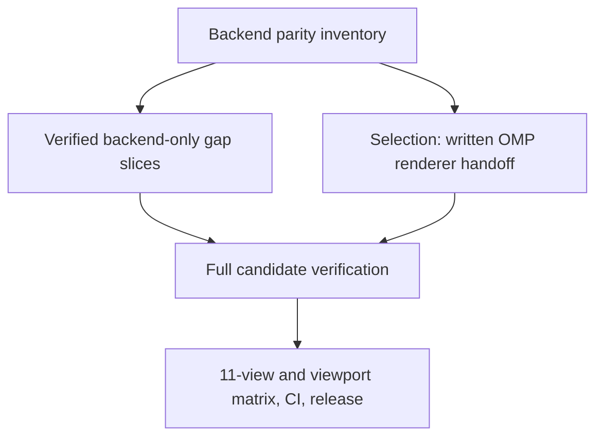
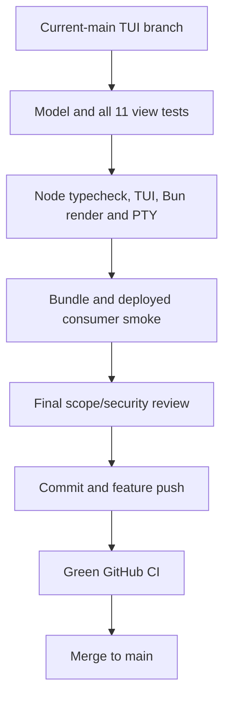

# NOMO TUI ownership and continuation plan

Status: planning and ownership reset, 2026-10-30.

## Purpose

This document is the single current handoff for finishing the production NOMO terminal UI. It replaces conflicting operational instructions, not historical evidence. It does not authorize copying another runtime, deleting user data, weakening NOMO security, or claiming old test results for new commits.

## User outcome

Deliver one reliable, interactive and visually coherent NOMO TUI inspired by useful Prime Agent and OMP patterns. Preserve NOMO branding, truthful Workbench data, existing security and approval contracts, terminal restoration, keyboard usability, monochrome behavior and short-terminal layouts. Every shipped control must invoke a real NOMO action or be omitted.

## Authority and ownership

1. `docs/CONTEXT.md`, `docs/DECISIONS.md`, `docs/STANDARDS.md`, source code and tests remain authoritative for behavior and security.
2. This plan is the current TUI roadmap. `.nomo/work-state.json` is the only execution graph. Obsidian and TheBrain hold status and provenance, not code authority. The imported `Graphify-Index` is historical until its root and indexed commit match the active source.
3. The clean isolated branch `tui/clean-continuation-2026-10-30` is the integration tree. It starts at GitHub `origin/main` commit `521b1c825c95ce3fdda71370aa3dfd8bef5e5dd2`. The integrator in this Prime Agent session owns this worktree and all integration commits.
4. OMP may contribute only through a written task assignment with explicit paths, acceptance, verifier, and return handoff. OMP does not write the integrator's branch. Its task branch must be separate and based on the same current main. The integrator reviews and cherry-picks only verified task-owned commits. The user reports that a new OMP session is now started; verify its exact new worktree/branch before assigning overlapping work. Its current visible `tui/final` tree is a mixed dirty snapshot, not the approved OMP task branch.
5. OpenCode no longer owns a TUI worktree, branch, or remote branch. The `feat/tui-ink-rework` worktree and branch were intentionally removed at the user's explicit request. Do not recreate or adopt the experimental Ink/TUI v2 implementation. Its previous status included demo data and fake actions.
6. The dirty root checkout and all unrelated dirty worktrees are protected. No reset, clean, checkout, delete, cherry-pick, commit or push from those trees.

## Preservation and cleanup rule

Do not delete notes, branches, commits, or dirty files based only on age, filename, or author label. Preserve verified historical evidence. To stop obsolete guidance being followed, create a current index that labels superseded plans as historical and points to this plan, the active graph, and current source. Only archive or remove a specific item after inventory, provenance review, duplicate check, and confirmation that no current task or link depends on it. Never bulk-delete from TheBrain or the Obsidian vault. Keep the original vault intact.

## Visual requirements for the current request

The Prime Agent TUI is the primary visual reference. OMP is a source of reusable patterns, not a second product contract. This updates the older dated parity note that named OMP first. Use current Prime Agent v0.10.1 source for comparable shell/editor behavior, and OMP v18.8.9 only for component patterns that fit NOMO. Do not import Prime or OMP branding, runtime, actions, or fake data.

- Use the supplied NOMO six-by-six grid mark, English interface labels, monochrome state labels and transparent terminal canvas. Do not replace the terminal UI with a web-like card dashboard.
- Make chat the visual focus: concise role framing, readable Markdown and code, clear live streaming state when sourced from actual Workbench events, and a steady prompt/editor area that remains visible.
- Reduce repeated chrome and metadata. Use compact header and status rows, a context-sensitive shortcut legend, and the existing command palette. Show run/session detail in the inspector when width allows, not as duplicated JSON in the body.
- Keep all eleven NOMO tabs, each with real data, visible selection, usable empty/error/unknown states, and the existing action owner. Improve the view hierarchy without removing NOMO's operations surfaces.
- Follow terminal-native interaction patterns: selection, history, model selection, prompt editing, help and details. Port only when the binding preserves NOMO semantics and can be tested. In particular, approvals, side effects, run stop, queue capacity, and ledger evidence must remain NOMO-owned.
- Keep status meaning independent of color. Honor `NOMO_TUI_COLOR=0`, `NOMO_TUI_MOTION=0`, terminal foreground/background, reduced capability, no-color output, narrow columns, short heights and terminal restoration.

Reference matrix to complete before implementing parity changes:

| Surface                | Current NOMO owner and state source                                                       | Prime/OMP pattern to assess                                                     | Current tests                                                         |
| ---------------------- | ----------------------------------------------------------------------------------------- | ------------------------------------------------------------------------------- | --------------------------------------------------------------------- |
| Overview / runs        | `WorkspaceTui.items()` reads `Workbench.runs()`; stop/reconcile route through `Workbench` | Compact live run rows, detail inspector, honest unknown/reconciliation states   | `workspace-controls.test.ts`, `workspace-parity.test.ts`              |
| Chat                   | `WorkspaceTui.session()` plus `chatRows()` over Workbench events                          | Transcript hierarchy, streaming, Markdown/code, context-first editor dock       | `workspace.test.ts`, `workspace-parity.test.ts`                       |
| Prompt / queue         | `WorkspaceInput` and runner keys; send/queue/stop in Workbench                            | Unicode editing, history, multiline, contextual shortcut hints                  | `workspace.test.ts`, `workspace-controls.test.ts`, PTY verifier       |
| Sessions               | `Workbench.list()` and `Workbench.get()` for full detail                                  | Grouped selection, list+inspector at wide sizes                                 | `workspace-controls.test.ts`, `workspace-parity.test.ts`              |
| Documents              | `Workbench.documentsList()`, `document()`; edit and undo through Workbench                | Folder tree, read-only preview, version/revision status                         | `workspace.test.ts`, `workspace-controls.test.ts`                     |
| Ledger                 | signed managed proofs plus proxy records, verified by existing ledger/proxy owner         | Compact evidence rows and readable record detail, no raw secret arguments       | `workspace-controls.test.ts`, `workspace-proxy.test.ts`, ledger tests |
| Approvals              | `Workbench.approvals()` and proxy holds; y/n delegates to approval API                    | Decision detail next to list where space permits, explicit risk and expiry      | `workspace-approval.test.ts`, `workspace-controls.test.ts`            |
| Policy / connectors    | `Workbench.connectionState().connectors`; mutations via explicit connector methods        | Consent lifecycle and connector inspector, no inferred permissions              | `workspace-mcp.test.ts`, `workspace-controls.test.ts`                 |
| Tools                  | `Workbench.availableTools()` with registry disclaimers and schema                         | Searchable tool catalog and schema detail; inspection never executes            | `workspace.test.ts`, `workspace-controls.test.ts`                     |
| Models                 | `Workbench.providerState()` catalog; selecting model is explicit existing command         | Search/select capability metadata without claiming unsupported inputs           | `workspace.test.ts`, `workspace-settings.test.ts`                     |
| Usage                  | `activity(Workbench.allViews())`; missing cost remains unknown                            | Compact token usage details, no invented metrics                                | `workspace-parity.test.ts`, `workspace.test.ts`                       |
| Settings / themes      | Workbench preferences/limits and local theme config                                       | Searchable metadata and supported persisted preferences only                    | `workspace-settings.test.ts`, `theme-config.test.ts`                  |
| Help / command palette | static command catalog plus actual keybinding dispatch                                    | Discoverable commands and true active key hints                                 | `workspace.test.ts`, `workspace-shortcuts.test.ts`                    |
| Watch / hold / inline  | `WatchRuntime`, `renderHoldPrompt`, and caller-supplied verified state                    | OMP/Prime terminal component hierarchy only where fits shared-terminal contract | `tui.test.ts`, `live.test.ts`, `workspace-terminal.test.ts`           |

For every matrix row record source commit, disposition (`supported`, `safely adapted`, `unsupported`), concrete NOMO contract, before/after renderer evidence, and verifier. A reference screenshot without a tested NOMO behavior is not acceptance evidence.

## Phases

### 0. Ownership and source reconciliation

Owner: integrator. Paths: this plan, `.nomo/work-state.json`, and a new TUI start-here index in the NOMO memory system. Read-only source inventory first. Confirm the OMP session is stopped; record the exact candidate tree HEAD, dirty paths, staged state, and process ownership. Inspect current `origin/main`, every TUI branch, open PRs, TUI contracts, and historical plans. Preserve every tree. Exit when each candidate change is marked `verified-integrated`, `verified-unintegrated`, `unverified`, `foreign-owned`, or `obsolete-with-evidence`.

### 1. Current production baseline

Owner: integrator. The clean integration branch starts at current `origin/main`. Map all 11 production tabs to their Workbench read source, action owner, empty/error/unknown behavior, and focused test. The static source mapping is safe to complete while OMP owns TUI code. Runtime tests/typecheck/PTy are temporarily blocked because the clean worktree has no `node_modules`, and project instructions disallow dependency installation without approval. Do not run tests concurrently with OMP's live PTY work. Obtain either an isolated approved dependency setup or a completed OMP handoff plus clean test result before baseline gates. No implementation during source mapping.

### 2. Review and accept independent changes

Owner: integrator; OMP may propose isolated commits only after assignment. Review every TUI PR and dirty OMP change, including required shared Workbench or provider changes. Check security, correctness, tests, dependency and license changes, UI truthfulness, keyboard behavior, terminal lifecycle, and document consistency. Accept only minimal commits whose tests and typecheck pass on current main. Leave failed or uncertain work preserved and blocked, never silently fold it in.

Known remote branches and state observed on 2026-10-30:

- `tui/terminal-foreground`, PR 123, open, checks failed or cancelled.
- `tui/compact-overview`, PR 124, open, checks failed or cancelled.
- `tui/visual-refresh`, remote commit `0748d41`, no open PR returned by GitHub CLI; old local visual evidence applies only to that commit.
- `tui/upgrade-omp-parity`, remote commit `ab5c8d8`, no open PR returned by GitHub CLI.
- `tui/omp-continuation`, remote commit `346081f`, no open PR returned by GitHub CLI.
- OMP's older `main-current` tree was at `c6beb23`, 8 commits behind main, with 14 modified files across TUI, Workbench and PTY verifier. `git diff --check` passed. Focused regression run in that older tree passed one test and failed two stale expectations: run inspector expected `runId`, proposal detail expected JSON serialization. No files were changed there by Prime.
- OMP pushed `92be3e3`, `bf2abf1`, `bbb3e8d`, and `645a0d4` to `tui/final`. That branch is 4 commits ahead of its common base but 317 behind current main. OMP's graph currently blocks package-artifact launch on unresolved workspace imports and blocks delivery on GitHub auth. Its worktree has uncommitted changes to `workspace.test.ts` and `verify-tui-terminal.py`, plus unrelated staged/untracked changes; treat it as protected. OMP reports the earlier TUI 349/349 plus PTY and CLI typecheck passed; the current follow-up has not been fully rerun or pushed. Prime independently reproduced PTY marker and package-artifact defects; issues #125/#126 are open.
- Prime independently reviewed the initial staged TUI patch read-only. No confirmed security finding; the alleged stop/restore nesting issue was disproven by numbered source.
- Two candidate unit tests were rerun against OMP's latest TUI candidate: `workspace-controls.test.ts` and the focused harness-proposal assertion passed. CLI typecheck passed. The candidate PTY verifier itself is being modified by OMP, and the PTY command previously failed before matching frame updates; no current full-suite/PTTY pass is proven.
- The new user requirement is visual focus using Prime Agent as the primary reference, with OMP secondary. OMP current graph owns `packages/cli/src/tui/**` and a live terminal process. Prime will not edit renderer or PTY verifier until OMP hands off its visual slice. Prime integration remains this clean branch and is non-overlapping.
- Follow-up issues created: #125 fixes the PTY verifier markers against the current prompt contract; #126 tracks a resolved CLI asset-packaging issue. Both are source-backed verification/release blockers.
- At phase start, all branch and diff findings are candidates, not accepted progress. Do not close PRs or delete their remote branches until their ownership and disposition are recorded.

### 3. Functional correctness by ownership boundary

One issue per graph node. Add a failing `node:test` before changing behavior. TUI renders and routes input; Workbench owns state and actions; Proxy, policy and ledger own identity, authorization and evidence. Shared contract work must be assigned to its package owner and update the relevant acceptance docs before implementation. Preserve fail-closed behavior. No fake permissions, approvals, model data, receipts, metrics, tool outcomes or streaming events.

### 4. Reference interaction parity

Pin Prime Agent v0.10.1 and OMP `v18.8.9` sources per comparison. Maintain a matrix of feature, reference source, NOMO capability, disposition, NOMO owner, test and evidence. Use `supported`, `safely adapted`, or `unsupported`. Match only semantics NOMO can honestly support. Preserve the one-slot queued prompt contract unless a reviewed Workbench change authorizes otherwise. Do not require authenticated Prime screenshots; no OAuth or credentials are entered by an agent.

#### Backend editor action inventory

This inventory is limited to prompt-editor and runner actions owned by the backend. Tests name behavior; renderer-only interactions are excluded.

| Action                                                                                                            | Disposition    | Backend owner                                                         | Focused evidence                                                                                                                           |
| ----------------------------------------------------------------------------------------------------------------- | -------------- | --------------------------------------------------------------------- | ------------------------------------------------------------------------------------------------------------------------------------------ |
| Text entry, cursor movement, backspace and forward delete                                                         | supported      | `WorkspaceInput.key()`                                                | `workspace.test.ts`: composer cursor and multiline editing; `workspace-input-parity.test.ts`: Unicode limit and Ctrl+Home/Ctrl+End         |
| Enter submits; modified Enter and Ctrl+J insert newline; trailing backslash plus Enter inserts newline            | supported      | `WorkspaceInput.key()` and runner submit dispatch                     | `workspace.test.ts`: multiline editing, paste never submits; `workspace-runner.test.ts`: queued dispatch                                   |
| Bracketed paste normalizes line endings and strips terminal controls without submitting                           | safely adapted | `WorkspaceInput.paste()` / `WorkspaceInput.key()`                     | `workspace-runner.test.ts`: bracketed paste normalization; `workspace.test.ts`: multiline paste never submits                              |
| Ctrl+U, Ctrl+K, Ctrl+W, Alt+Backspace, Alt+D kill text; Ctrl+Y yanks; Alt+Y cycles kill ring                      | safely adapted | `WorkspaceInput.killText()`, `yank()`, `yankPop()`                    | `workspace-input-parity.test.ts`: kill-ring capacity, grouping, yank cycling, prompt limit and truncated-yank cycling                      |
| Ctrl+T transposes; Alt+B/F and Alt+Left/Right move by word; Ctrl+Left/Right aliases; Ctrl+Up/Down move paragraphs | safely adapted | `WorkspaceInput.editKey()`                                            | `workspace-input-parity.test.ts`: transpose, word boundaries, aliases and paragraph movement                                               |
| Ctrl+_ undo and Ctrl+Shift+Z redo                                                                                 | safely adapted | `WorkspaceInput.undoEdit()` / `redoEdit()`                            | `workspace-input-parity.test.ts`: Ctrl+U undo and redo preservation for no-op edits                                                        |
| Model cycling and configurable workspace shortcuts                                                                | safely adapted | `nextModelId()`, `workspaceShortcut()`, `parseWorkspaceKeybindings()` | `workspace-input-parity.test.ts`: catalog boundary and safe/atomic keybinding configuration                                                |
| Active-run cancellation, overlay Escape ownership and queued prompt recovery                                      | safely adapted | runner cancellation and queued-dispatch helpers                       | `workspace-runner.test.ts`: cancellation precedence, dispatch lock, retry-on-failure and queue readiness                                   |
| Host system clipboard, suspend, Vim editing, image paste and backgrounding                                        | unsupported    | no backend action; no renderer affordance                             | `packages/cli/src/tui/README.md` explicitly states no NOMO equivalent; system clipboard also requires separate approval and privacy design |

The limit-boundary regression found that yank-pop stored the source ring entry length rather than the truncated inserted range. It now stores the actual inserted length, so repeated Alt+Y can cycle safely without deleting adjacent prompt text.

#### Workspace command action inventory

`WorkspaceTui.command()` is the dispatcher and calls the Workbench for all stateful operations; it does not duplicate policy. Command groups below cover each command in `TUI_COMMANDS`; each row lists the handler and focused evidence. A command that needs confirmation retains it in the UI/Workbench path rather than applying it on inspection.

| Commands                                                                                                                                                                                                              | Disposition and actual owner                                                                                                                                                  | Focused evidence                                                                                                                     |
| --------------------------------------------------------------------------------------------------------------------------------------------------------------------------------------------------------------------- | ----------------------------------------------------------------------------------------------------------------------------------------------------------------------------- | ------------------------------------------------------------------------------------------------------------------------------------ |
| `/new`, `/clear`, `/chat`, `/bottom`, `/find`, `/sessions`, `/resume`, `/open`, `/runs`, `/overview`, `/documents`, `/ledger`, `/approvals`, `/usage`, `/tools`, `/policy`, `/permissions`, `/help`, `/quit`, `/exit` | supported; `WorkspaceTui.command()` routes view aliases through `workspaceTab()`, session changes through `useSession()`, and data comes from Workbench read methods          | `workspace.test.ts`, `workspace-parity.test.ts`, `workspace-controls.test.ts`                                                        |
| `/model`, `/models`, `/providers`, `/login`, `/logout`, `/connect`, `/verify`                                                                                                                                         | supported; `WorkspaceTui.selectModel()`, `openModelPicker()`, and provider/ledger Workbench APIs enforce current catalog, setup and signature checks                          | `workspace-models.test.ts`, `workspace-parity.test.ts`, `workspace-controls.test.ts`, `workspace.test.ts`                            |
| `/queue`, `/cancel`, `/stop`, `/retry`, `/branch`, `/rewind`, `/recovery`, `/undo`, `/diff`, `/diff-next`                                                                                                             | safely adapted; `WorkspaceTui.command()` and recovery helpers preserve queue readiness, Workbench stop/retry authority, and reviewed recovery confirmation                    | `workspace-runner.test.ts`, `workspace-controls.test.ts`, `workspace-approval.test.ts`, `workspace.test.ts`                          |
| `/plan`, `/stats`, `/cost`, `/context`, `/status`, `/health`, `/discover`, `/todos`, `/compact`, `/memory`, `/learned`, `/config`, `/doctor`, `/conformance`                                                          | safely adapted; `WorkspaceTui.command()` derives reports from live Workbench/runtime results and marks unknown or unsupported capabilities                                    | `workspace-parity.test.ts`, `workspace-controls.test.ts`, `workspace-settings.test.ts`, `workspace.test.ts`                          |
| `/projects`, `/project`, `/project-file`, `/agents`, `/agent`, `/agent-file`, `/hooks`, `/hook-file`, `/hook`, `/subagent`, `/harness`                                                                                | safely adapted; Workbench owns persistence, validation, verified child relationships, review and runtime allowlists; command handlers only select or prepare reviewed actions | `workspace-controls.test.ts`, `workspace-harness-proposals.test.ts`, `workspace-harness-rows.test.ts`, `workspace.test.ts`           |
| `/mcp`, `/connect opencode:zen`, `/export`, `/attest`, `/init`, `/settings`, `/theme`, `/keybindings`, `/expand`, `/document`, `/edit`, `/history`, `/rename`, `/filter`, `/source(s)`, `/provider(s)`                | safely adapted; `WorkspaceTui.command()` dispatches to Workbench-owned connector, storage, export, configuration and document APIs, or local bounded view state               | `workspace-mcp.test.ts`, `workspace.test.ts`, `workspace-settings.test.ts`, `workspace-parity.test.ts`, `workspace-controls.test.ts` |
| `/vim`, `/terminal-setup`, `/output-style` and host clipboard, suspend, image paste, backgrounding                                                                                                                    | unsupported; dispatcher explicitly refuses unsupported command aliases and no host action is provided                                                                         | `packages/cli/src/tui/README.md`; system clipboard separately requires explicit approval and privacy design                          |

Contract spot-check: `/model <id>` rejects anything outside the current connected provider catalog, and the regression suite covers the available, stale/unavailable and no-provider cases in `workspace-models.test.ts`. `WorkspaceTui.command()` defaults `/export` to `ledger`; the lifecycle regression explicitly exercises `/export ledger` and verifies signatures and secret exclusion in `workspace.test.ts`. This inventory documents existing test evidence; it does not claim untested command variants are separately covered.

### 5. Visual finish

Do not restart a completed broad visual pass without a new concrete defect. For each defect: capture the actual production renderer before change; add a failing exact-size and mode regression; make a presentation-only patch; capture after; check Unicode terminal-cell widths; inspect color and monochrome; run focused test and typecheck. Matrix: 40x12, 80x24, 120x40, 200x48, all 11 tabs, color and monochrome. Keep user-authored text unchanged. No unsupported cards or actions.

### 6. Consolidation and release

On a clean candidate branch, run `pnpm run test:tui`, `pnpm run typecheck`, and `python3 scripts/src/verify-tui-terminal.py` serially after focused tests. Run full CLI tests if the diff spans more than the TUI renderer. Review exact branch diff against `origin/main`; reject secrets, unrelated docs, generated archives, and foreign hunks. Commit each reviewed slice separately. Push feature branch. Require green CI before merge. Main merge and deployment are distinct release gates.

## Active continuation graph

The sole execution graph is `.nomo/work-state.json`. Its current active task is the backend parity inventory. The verified backend fix retains only the newest 16 kill-ring entries; the test first reproduced unbounded growth, then the focused suite verified cyclic wrap.

Selection remains blocked until written OMP handoff. System clipboard remains unsupported without separate explicit user approval and privacy design. Full verification waits for visual-branch integration; release waits for exact-candidate tests and green CI.

## 2026-10-31 renderer integration checkpoint, historical

This records the implementation and evidence at that checkpoint only. It is superseded by the 2026-11-08 Node runtime cutover below. The user approved the renderer candidate at the time. The integrated implementation was in the then-current integration branch, created from `origin/main` `521b1c8`. The note records the files ported and the thirty backend commits then present.

At that checkpoint, the interactive application imported `WorkspaceApp`; Node 24 interactive sessions re-executed through Bun and Node 26.4+ used the documented FFI flag. The reported test, build and isolated-consumer results below are historical and do not describe the current branch.

Checkpoint evidence reported at the time: `pnpm run test:tui` with 305 Node tests, 21 Bun renderer tests and terminal smoke; bundle tests 14/14; bundle build, typecheck, Prettier and doc-truth; offline isolated consumer `--help`, `--version`, Node 24 `tui --once` and interactive terminal launch/exit.

The then-remaining gates were exact diff review, feature push and green GitHub Actions. No claim is made here that those gates were completed.

## 2026-11-08 Node runtime cutover

The current integration worktree uses `WorkspaceTui`, `renderWorkspace`, and the Node terminal adapter. CI no longer provisions Bun for a renderer suite. The CLI package no longer declares a separate interactive-renderer runtime, and its lockfile has no such packages. Other workspace packages still use React. `workspace.ts` remains OMP-owned for visual work, and `workspace-runner.ts` is released to OMP for non-Chat control-dispatch parity; neither path is part of this cutover author's remaining write scope.

The historical test counts remain attributable to that earlier run and are not current evidence. Runtime build and typecheck verification were pending a stable OMP handoff because the same worktree was active.

Prime continuation checkpoint, 2026-11-08: at HEAD `cef76c9c3031638a2ddbd9d1e2b2ba5398e00a60`, changed runtime-owned paths are `.github/workflows/ci.yml`, `docs/TUI-WORKSPACE.md`, this plan, `package.json`, `packages/cli/package.json`, `packages/cli/tsconfig.json`, `packages/cli/src/tui/README.md`, `packages/cli/src/tui/workspace-brand.test.ts`, `packages/cli/src/tui/workspace-runner.test.ts`, `rollup.config.mjs`, `scripts/src/bundle-cli.test.mjs`, and `scripts/src/check-tests.mjs`. The current source handoff is pending; OMP's process was still present in the integration worktree at the last status check. No bundle build, typecheck, suite, commit, push, merge or deploy was run in this continuation. Static checks passed: `node --check` on the three changed JavaScript modules, Python JSON/JSONC parsing for the two package manifests and CLI tsconfig, PyYAML parsing for CI and lockfile, and `git diff --check`. The bundle refresh, CLI version check and PTY smoke remain the next runtime-owned steps after OMP releases its shared sources.

## Ownership split

- Prime Agent integrator: source of truth, task graph, isolated integration worktree, review, acceptance, cherry-pick, final commits, feature push, and release report.
- OMP contributor: explicitly assigned non-overlapping TUI behavior or test slice in its own worktree; no shared package or policy edits unless assigned; deliver commit hash, files, RED/GREEN, exact gates, limitations, and stop reason.
- No OpenCode TUI v2 lane exists. No third writer. Do not run parallel work in the same file or branch.

## Acceptance gates

- All supported views show only actual Workbench data and explicit unknown/error states.
- Every visible action maps to a tested owner method and cannot bypass policy, approval, idempotency, or ledger checks.
- No fake actions or placeholder production values.
- Tests and typecheck pass on the exact release candidate. PTY verifies launch, key path, cancellation, signals and terminal restoration.
- The full viewport matrix has bounded lines, reachable prompt, readable details, and monochrome state meaning.
- The final diff contains only reviewed TUI task-owned files and necessary shared-contract changes.
- Work Log and task graph state match the actual remote commit and CI. Old notes remain archived or explicitly superseded, not silently deleted.

## Verified quality and blocking issues

- Clean-main baseline at 521b1c8: `pnpm install --offline --frozen-lockfile --ignore-scripts` passed with no lockfile change. `pnpm run typecheck` passed. Workbench suite passed 856, skipped 2, failed 0. TUI suite first reported 191 passed/15 failed. The approval test fixture omitted OpenAI `finish_reason`; adding `tool_calls`/`stop` to the disposable fixture kept all no-dispatch-before-approval assertions and made the focused approval test pass 1/1. Re-run TUI then reported 192 passed/14 failed, same other failures. No TUI production source changed. Issue #127 has exact triage and outputs.
- OMP candidate latest pushed HEAD is `bbb3e8d`, 3 commits ahead of merge base 620aea4 and 317 commits behind main. Its graph reports `pnpm run test:tui` passed 346 tests plus PTY, and CLI typecheck passed. These are reported by the candidate owner; not independently rerun on its exact pushed HEAD. Workspace-wide typecheck is blocked by malformed unrelated `packages/workbench/src/provider-adapters/openai-responses.test.ts` (TS1434). No OMP candidate commit has been cherry-picked.
- Issue #125, current PTY verifier waits for obsolete prompt marker; actual clean-main PTY stops before key scenarios. The prompt contract has been redesigned in the candidate. Fix and verify on OMP branch.
- Issue #126, the candidate bundle depended on a runtime image asset that `npm pack` did not include. The current in-source grid mark removes that packaging dependency.
- Issue #127, clean-main baseline has 15 TUI failures. They include one approval dispatch fixture, run fixture status, project root setup, layout assertions, prompt navigation, TODO rendering, icon color, prompt-jump counts, document lifecycle, history search and rewind. Separate true regressions from stale fixtures; never delete tests to go green.
- GitHub PRs #123 and #124 remain OPEN with failed/cancelled checks. `gh` annotations for gates report the account billing/spending limit issue, linked to existing issues #98/#110. No billing/account modification or PR merge until the owner resolves CI and checks are green.
- Obsidian Control Center and Work Log have current OMP ownership and issue records. The TheBrain local API is unavailable, so no write is claimed. Graphify `.graphify_root` is absent from the imported Obsidian vault; do not use its stale generated code graph as current evidence.

## 2026-11-09 Hybrid TUI direction and completion plan

Status: current source-backed proposal, not a claim of completed TUI work. This section supersedes older Chat-style and ownership statements above where they conflict with the user's 2026-11-09 instructions. The active execution state remains `.nomo/work-state.json`.

### Research baseline

- NOMO source observed in the existing dirty integration worktree at `cef76c9c3031638a2ddbd9d1e2b2ba5398e00a60`. The working tree has extensive unrelated and in-progress changes. Do not reset, clean, or create another worktree.
- OMP source is pinned at `/Users/dawe/Developer/upstream/omp-src`, commit `1c0993c3d12e70042169a951663bb2702e2c0a9e`. Prime source is pinned at `/Users/dawe/Developer/upstream/prime-src`, commit `71beca9478f552dc6fc898bba9685f9ce00515cf`. Both reference trees were clean at audit time. Re-check revisions before future comparisons.
- Understand Anything's existing root graph has 5,147 nodes and 6,324 edges, no duplicate IDs or dangling endpoints, and describes root commit `98964ede79b80fb77e46c07372d0f6edc0e97d70` from 2026-11-04. Its `meta.json` is absent, so it is not a current integration-worktree graph. Treat it only as navigation. Graphify's `.graphify_root` is absent, so its imported output is not a current source map either.
- A fresh Understand Anything scan of the active worktree found 1,228 tracked files. Seven old tracked paths are absent from the current worktree, including the deleted legacy renderer paths. Focused structure extraction covered 269 TUI, Workbench, ledger, proxy, and desktop-setup files: 269 structures succeeded, 267 call graphs succeeded, two non-code call graphs were skipped, and no import-resolution or file-read failures occurred. The selected source set has 812 internal import edges. Temporary scan outputs were kept outside the repository. This is a deterministic structural map, not a semantic full-repository graph.
- The current runtime is `WorkspaceTui` plus `renderWorkspace()` in `packages/cli/src/tui/workspace.ts`, dispatched by `workspace-runner.ts` and painted by the row-diff terminal adapter in `workspace-terminal.ts`. The renderer already has framed on-demand panels; navigation and action coverage still need source-by-source reconciliation. `blocks.ts` defines reusable chat blocks but the active renderer does not currently use that component path.
- Prime's `ChatEntry` is a typed transcript vocabulary; its user block is padded and styled with `UserMessageBg`. Its activity dock reads subagent counts, heartbeat catalog, and shell state from runtime data. OMP uses typed user, assistant, and tool transcript components, per-role user-card tone, and a provider-aware Model Hub. Their source structures are useful patterns, not NOMO behavior contracts.
- NOMO already has Workbench-backed event kinds, a provider-scoped `providerModelsProjection()`, approval and ledger owners, prompt-row anchors, and Chat input dispatch. Workbench currently exposes no heartbeat runner, so the Chat dock now says `unavailable` or compact `n/a` instead of presenting a fabricated zero.

### Product target

Build a NOMO-native hybrid that combines Prime's stable chat/editor/activity composition with OMP's contextual overlays, command palette, typed transcript components, and provider/model browser. Keep NOMO's Workbench policy, approval, ledger, provider, and action ownership. Do not copy either harness runtime or branding.

- Chat is the only base workspace. Remove Overview from the visible navigation. Open secondary panels from the command palette or their existing slash commands, then return to Chat with Escape after the focused detail or filter closes. Keep the nine named surfaces: Chat, Sessions, Documents, Ledger, Approvals, Tools, Models, Usage, and Help. Keep policy enforcement and `/policy`, `/permissions`, and `/policy-file`; do not restore a standalone Policy screen. `/settings` remains a real, reachable configuration panel.
- Chat uses a responsive transcript, a lightly rounded, theme-derived composer inspired by the Prime/OMP references, and an activity dock. The composer has a visible `>` prompt and caret, starts in collapsed mode, expands with `Ctrl+0`, and contains no helper sentence, model name, working path, mode, or message count. Its top rail shows context capacity and used percentage only. Do not draw an outer frame around the Chat viewport. User messages get a theme-aware, padded role card like Prime/OMP, with no `YOU` heading. These surfaces may paint only their own rows. The terminal canvas always inherits the user's background.
- Assistant, tool, error, and usage rows remain distinct. Show only truthful runtime phases such as Thinking, Calling tool, and Writing response. Do not render private chain-of-thought text. Preserve `promptStart` anchors and all send, stop, queue, confirmation, and approval semantics.
- Models is a provider-scoped browser. Provider and model focus switch with Left/Right; Up/Down and search act on the focused pane. Show only the selected provider's catalog, fetched only on explicit provider focus or refresh. Never merge catalogs or invent pricing, speed, context limits, capabilities, roles, or categories. Keep credentials in NOMO's approved secure configuration paths; never scrape or log another harness's secret store.
- Settings is an interactive, grouped panel for every currently supported TUI preference, workspace shortcut override, and Workbench run limit. A high-contrast selected row and visible cursor track keyboard and mouse selection; Left/Right and Enter change choices, numeric and text values have inline editors, and the viewport follows the selected row. Appearance and shortcut preferences persist in local TUI state unless an explicit `NOMO_TUI_*` environment value overrides them; Workbench values persist through the local settings store. Do not invent settings that have no NOMO runtime consumer. Every panel uses NOMO data, deliberate hierarchy, visible focus and truthful empty, unknown, unavailable, and error states. Ledger details remain structured and redacted, with chain integrity separate from signature status.
- Reuse the existing terminal renderer and palette. Maintain one semantic icon registry with text labels, terminal-safe Unicode/ASCII fallbacks, and an explicitly selected Nerd Font preset for terminals whose font supports it. Use MIT-licensed Iconoir SVG artwork only where a supported terminal graphics protocol can render it; never require patched fonts silently. Motion must preserve layout geometry, stay subtle, and stop under `NOMO_TUI_MOTION=0`. Respect `NO_COLOR`, `NOMO_TUI_COLOR=0`, terminal color depth, the selected theme, inherited canvas, resize, narrow/short terminals, and terminal restoration. Do not add an unnecessary interactive-renderer runtime dependency.

### Quality bar that exceeds the references

“Better” is measured by behavior and rendered output, not by visual imitation. The candidate is acceptable only when:

1. Every visible shortcut, palette command, tab hit target, and selectable row reaches one real NOMO handler. Focus precedence keeps typed Chat text, completion, panels, confirmations, and global shortcuts separate.
2. Every displayed count and status has a named Workbench/runtime source. Unsupported heartbeat or shell data is hidden or marked unavailable, never synthesized as zero activity.
3. All nine panels and `/settings` remain useful at 40x12, 80x24, 120x40, and 200x48. No text or details clip silently; selection, prompt, and scroll anchors remain stable after resize.
4. Rendering does not clear the screen on ordinary refresh or resize. The diff painter updates only changed rows, layout height stays stable, and the user can read streaming output without repeated jumps or flashes.
5. Color, no-color, ASCII, high-contrast, inherited background, and reduced-motion modes carry the same meaning. User-message tint never paints the full terminal.
6. Icons have central semantic names, documented sources, a terminal-capability path, and a readable Unicode or ASCII fallback. Nerd Font glyphs are an explicit opt-in because terminal font coverage cannot be detected reliably. Icon presence never replaces a visible text label or changes layout width unexpectedly.
7. Motion remains readable and stable: animation updates do not move the cursor, resize the composer, repaint the whole screen, or flash the transcript; reduced motion disables every decorative animation.
8. Workbench remains the only authority for providers, approvals, tool execution, ledger claims, and mutations. The UI cannot widen consent, bypass confirmation, or perform network calls while rendering.
9. A built local `nomo` reports version 1.0.1 and opens the same source revision shown by `nomo --version` and the launcher path. The user can inspect the exact candidate with `nomo`.

### Dependency-ordered completion

Continue in this order inside the existing `.nomo/work-state.json` graph. Keep one owner per path and add no worktree.

1. **Chat composer and transcript:** keep the lightweight rounded composer surface, visible caret, `Ctrl+0` expand/collapse, theme inheritance, context-capacity percentage, user-message card, and structured assistant/tool/error rows. Correct resize and narrow-width behavior before adding more visual motion.
2. **Control dispatch map:** compare every supported non-Chat action against OMP's pinned keybinding registry, input controller, palette, mouse path, and rendered hints. Preserve NOMO's bindings where OMP semantics conflict with Chat input or policy. Verify Escape restoration, selection, search, scroll and clipboard behavior against real NOMO handlers.
3. **Unified icon system:** use Codicons glyphs from the Nerd Fonts map for the explicit `nerd` symbol preset, with normal Unicode and ASCII fallbacks. Use Iconoir as the MIT artwork source for supported image-capable terminals. Connect semantic names to all applicable settings, panel titles, status indicators, providers, models, lists and activity rows. Keep explicit font/terminal selection plus readable fallbacks; never depend silently on a patched font or terminal image protocol. Do not add packages until the existing asset path proves insufficient.
4. **Models and providers:** complete provider/model pane focus, per-provider catalog load, search, selection, current-provider activation, unavailable states, and safe credential source UX. Keep model metadata sourced from provider catalog data.
5. **Panel-by-panel design:** refine Sessions, Documents, Ledger, Approvals, Tools,
   Usage, Help, and Settings. Settings follows OMP's focused-list pattern with
   grouped controls, a visible cursor, current-value summary, searchable
   settings, and direct editing for every existing TUI/Workbench control. Panel
   titles and controls use the shared semantic icon preset. Give every screen
   consistent hierarchy and purposeful motion. Preserve `/verify`, exports,
   approvals, undo, and existing policy contracts.
6. **Motion and terminal stability:** source every subagent/shell/heartbeat indicator from runtime data; add a Workbench projection only if the domain owner has a real source. Measure redraw and layout behavior. Fix flicker at its cause. Keep animation geometry stable and honor reduced-motion mode.
7. **Local 1.0.1 acceptance:** run the required CLI typecheck and bundle build, refresh the existing local launcher, confirm `nomo --version` reports `1.0.1`, and inspect the exact output with `nomo`. Per the user's current instruction, do not run automated TUI suites or PTY tests. Record that omission and keep visual acceptance pending until the user reviews the local build.

### Understand Anything continuation

Use the installed `understand` skill and its already-built local plugin. The current structural scan is a fresh, scoped input for this dirty branch, not a replacement for the repository-wide graph. Do not overwrite root `.ua/knowledge-graph.json` with a worktree snapshot or create another persistent worktree graph. After the integration source baseline is stable, run the supported Understand Anything full or incremental pipeline against the chosen canonical checkout, validate its final graph and coverage, record excluded/deleted paths, and only then update the root `.ua` index. Until then, use the 269-file extraction plus direct source review for TUI questions. Use Graphify only after `.graphify_root` matches the exact checkout and source revision.

### Current slice evidence and next action

- The user clarified that their messages must be visibly highlighted like Prime/OMP while retaining no `YOU` heading. NOMO now has theme-specific user foreground/background tokens and padded user rows in `workspace.ts`; the background is confined to those rows, with a visible monochrome marker. CLI typecheck passed, the local bundle rebuilt with seven chunks / 2664 kB, and `/Users/dawe/.local/bin/nomo --version` returned `nomo 1.0.1`; the launcher targets this active worktree.
- Automated TUI suites and PTY checks were not run per user instruction. Visual acceptance remains open until the user inspects the refreshed build with `nomo`; continue the remaining ordered slices afterward.

### 2026-11-09 Chat shell checkpoint

- Removed the composer border hint and Chat-only logo wordmark; kept the > prompt and key behavior. Header now has explicit ready/working/review status and a motion-aware marker; transcript wrapping reuses cached rows when event history and layout options are unchanged.
- Verification: CLI typecheck passed; the existing local bundle rebuilt (nomo.mjs, seven chunks, 2664 kB); scoped diff check passed; the obsolete hint is absent from TUI source; local nomo --version reports 1.0.1. Automated TUI suites and PTY were not run per user instruction. No visual inspection by Codex, so acceptance remains open.
- Prime session 01a1b84e-a59c-708f-99bc-08a47b665a37 is live and working under PID 55017 after receiving a scoped coordination request; its daemon was not stopped.

### 2026-11-09 structured Chat events

- Completed tool results and errors now use the existing semantic block renderer; running tool events remain explicitly marked running. Persisted legacy HTTP 503 wording is corrected only at display time.
- CLI typecheck and local bundle build passed (seven chunks, 2676 kB); scoped diff check passed. No TUI suites or PTY run per user instruction.

### 2026-11-09 compact tool block follow-up

- Structured completed-tool blocks honor the compact-tools preference with a four-row body budget and an explicit hidden-line count. Full mode remains expanded; running tools remain distinct.
- CLI typecheck and bundle build passed (seven chunks, 2676 kB); scoped diff check passed. No TUI suites or PTY run per user instruction.

### 2026-11-09 model picker query control

- Left/Right continue switching provider/model focus. Ctrl+Left/Right now moves the search caret when the models pane has a non-empty query; visible help identifies the caret binding.
- CLI typecheck and local bundle build passed (seven chunks, 2676 kB); scoped diff check passed. No TUI suites or PTY run per instruction.

### 2026-11-09 Models help parity

- The global keybindings screen now documents the Models picker Left/Right pane switch and Ctrl+Left/Right search caret bindings.
- CLI typecheck and local bundle build passed (seven chunks, 2677 kB); scoped diff check passed. No TUI suites or PTY run per instruction.

### 2026-11-09 narrow Models help

- Models picker now uses a concise navigation/search/close hint below 50 columns so its essential controls remain visible; wider layouts keep detailed controls.
- CLI typecheck and local bundle build passed (seven chunks, 2677 kB); scoped diff check passed. No TUI suites or PTY run per instruction.

### 2026-11-09 compact Models pane visibility

- In compact Models picker layout, provider focus now shows the provider rows and model focus shows that provider catalog. Scroll anchoring follows the active selection in both compact and split layouts.
- CLI typecheck and local bundle build passed (seven chunks, 2677 kB); scoped diff check passed. No TUI suite or PTY run per instruction.

### 2026-11-09 narrow Models mouse selection

- Click hit targets now include compact-layout provider rows while the provider pane is focused. Single-click selects; double-click triggers the existing provider catalog load.
- CLI typecheck and bundle build passed (seven chunks, 2678 kB); scoped diff check passed. No TUI suite or PTY run per instruction.

### 2026-11-09 narrow Chat status footer

- Chat now uses a two-line status footer below 72 columns so model/session navigation and token/cost values remain independently visible; wider terminals keep the aligned one-row status.
- CLI typecheck and local bundle build passed (seven chunks, 2678 kB); scoped diff check passed. No TUI suite or PTY run per instruction.

### 2026-11-09 Chat tool timestamp consistency

- Compact running-tool summaries now reuse the timestamp-aware label. Turning timestamps off removes timestamps from this path; turning them on does not duplicate the timestamp.
- Verification: `pnpm --filter @nomo/cli run typecheck` passed; `node scripts/src/bundle-cli.mjs` built seven chunks / 2678 kB; scoped `git diff --check -- packages/cli/src/tui/workspace.ts` passed; `/Users/dawe/.local/bin/nomo --version` returned `nomo 1.0.1`, and the launcher targets this integration worktree. No TUI suites or PTY ran per user instruction.
- This is one incremental slice. Full TUI implementation and visual acceptance remain open.

### 2026-11-09 responsive diff inspector

- `/diff` now renders to the current inner viewport width and body height. Its detail rows refresh when the viewport changes size while retaining the existing `DiffViewState`, cursor, and staged hunks.
- Verification: CLI typecheck passed; the local bundle built seven chunks / 2679 kB; scoped `git diff --check` passed; `/Users/dawe/.local/bin/nomo --version` returned `nomo 1.0.1`. No TUI suites or PTY ran per user instruction.
- Full TUI completion and manual visual acceptance remain open.

### 2026-11-09 responsive Tools inspector

- Tool input schemas in the Tools inspector now receive the current content width instead of a fixed 76-column layout; redraws use the latest width.
- Verification: CLI typecheck passed; the local bundle built seven chunks / 2679 kB; scoped `git diff --check` passed; `/Users/dawe/.local/bin/nomo --version` returned `nomo 1.0.1`. No TUI suites or PTY ran per user instruction.
- Remaining panel responsiveness and complete TUI acceptance remain open.

### 2026-11-09 responsive detail renderers

- Provider, agent, memory, connector, usage, ledger, document, Tools-schema and activity details now use the current workspace content width rather than fixed 76-column rendering. The standalone approval-detail helper still has its own explicit 76-column contract.
- Verification: CLI typecheck passed; local bundle built seven chunks / 2679 kB; scoped `git diff --check` passed; `/Users/dawe/.local/bin/nomo --version` returned `nomo 1.0.1`. No TUI suites or PTY ran per user instruction.
- Full responsiveness and visual acceptance remain open.

### 2026-11-09 responsive approvals inspector

- Approval review details now receive the current content width, keeping fields and long waiting reasons responsive to the active panel.
- Verification: `pnpm run typecheck` passed across the workspace; the local bundle built seven chunks / 2679 kB; `git diff --check` passed; `nomo --version` returned `nomo 1.0.1`. No TUI suites or PTY ran per user instruction.

### 2026-11-10 Prime-style composer and icon-system roadmap

- The default composer uses a lightly rounded, theme-derived input surface with no outer Chat frame or in-composer helper text. It keeps the `>` prompt and visible caret, starts at one input row and grows with wrapped draft text; `Ctrl+0` expands it up to eight rows. The line above it shows auto-fit/expanded state. The composer rail shows only context capacity and used percentage; the separate bottom status keeps the truthful `manage` action. `/settings chat.frame rounded` selects the rounded style; filled, square, and double styles remain available. The terminal canvas remains untouched.
- Icon research recommends Iconoir as the MIT SVG artwork source, not as a direct text glyph set. Official Iconoir repository describes 1,383 outline and 288 solid SVG icons; the existing NOMO `brand.ts` path already loads local PNG tab assets through Ghostty's Kitty graphics protocol. Keep a central semantic name map and text/ASCII fallback for terminals without image support. Nerd Fonts provide a much larger PUA catalog but require a compatible patched font and per-source license review, so they must remain optional. Hugeicons Free Stroke Rounded is also MIT but targets SVG/React rendering and adds no terminal advantage. References: [Iconoir README](https://github.com/iconoir-icons/iconoir#readme), [Iconoir MIT license](https://github.com/iconoir-icons/iconoir/blob/main/LICENSE), [Nerd Fonts glyph sets](https://github.com/ryanoasis/nerd-fonts/wiki/Glyph-Sets-and-Code-Points), [Nerd Fonts license](https://github.com/ryanoasis/nerd-fonts/blob/master/LICENSE), [Hugeicons license](https://hugeicons.com/license-agreement).
- Verification for this slice: `pnpm --filter @nomo/cli run typecheck` passed; `node scripts/src/bundle-cli.mjs --quiet` passed; `/Users/dawe/.local/bin/nomo --version` returned `nomo 1.0.1` and its launcher points to this worktree; scoped `git diff --check` passed. No TUI suite or PTY ran. Visual appearance, `Ctrl+0` delivery, mouse/key interaction, and expanded icon coverage remain open for manual acceptance and implementation.
- Roadmap decision: continue only in this existing plan and `.nomo/work-state.json`. Next slices are OMP control-dispatch parity, a cross-terminal semantic icon registry using Iconoir assets where supported, panel/settings icon and motion consistency, provider/model truth, measured no-flicker redraw behavior, and final local `nomo` review. Do not claim completion until the exact local build is inspected and the supported interactions work.

### 2026-11-10 Semantic icon preset

- Added an explicit `nerd` symbol preset backed by named Codicons code points from the official Nerd Fonts 3.5.1 glyph map. The mapping follows meaning for workspace areas, roles, status, settings, and activity. Settings rows choose icons from the setting key, and the Chat activity dock uses agent, pulse, and terminal glyphs from the same map.
- Preset is opt-in because terminal font coverage cannot be detected reliably. Default `unicode` and the `ascii` fallback remain available. The Settings help identifies the Nerd Font requirement; no package or patched font is installed. Iconoir artwork remains planned for terminals that support local Kitty graphics assets.
- Verification: `pnpm --filter @nomo/cli run typecheck` passed; `node scripts/src/bundle-cli.mjs --quiet` passed. No TUI tests or PTY ran per user instruction. Visual glyph rendering remains unverified until inspected in the user's terminal. Broad conversion of every static row icon to the semantic registry remains an open TUI slice.

### 2026-11-10 Interactive Settings controls

- Replaced the static `/settings` inspector with a grouped, OMP-style control list for color theme, symbol set, composer surface, Chat spacing, timestamps, tool activity, and every bounded Workbench run limit. A visible `▸` cursor follows keyboard selection and mouse clicks; double-click activates a row. Left/Right and Enter cycle choices, numeric rows open an inline editor with cursor, `Ctrl+A`, backspace, delete, and bounded Workbench read-back. Wheel and page keys move selection; the list keeps the selected row visible after resize.
- Theme, color, motion, and composer controls are session-scoped and show environment persistence guidance. Tool visibility saves immediately in local TUI state; Workbench numeric and text settings persist through the local Workbench settings store. No provider, approval, permission, or unsupported runtime setting was added.
- Verification: `pnpm exec prettier --write packages/cli/src/tui/workspace.ts packages/cli/src/tui/workspace-runner.ts`, `pnpm --filter @nomo/cli run typecheck`, `node scripts/src/bundle-cli.mjs --quiet`, `/Users/dawe/.local/bin/nomo --version` (`nomo 1.0.1`), and scoped `git diff --check` passed. No TUI tests or PTY ran per user instruction. Keyboard, mouse, resize, and visual acceptance remain unverified in a live terminal.

### 2026-11-10 Settings coverage follow-up

- Added the persisted Workbench `refinementModel` to Settings as a validated text editor with a visible scrolling cursor. An empty value restores conversation-model inheritance. `refinementEnabled` now uses an on/off selector instead of a misleading fixed numeric label; `/settings refinementEnabled 0|1` remains compatible.
- Added live terminal color and motion selectors. They are session overrides and show their environment persistence instructions. Long model IDs keep the caret visible in narrow layouts.
- Reworded the active bundle guard to require the workspace renderer to import only Node built-ins and local chunks; removed stale renderer names from active docs and test descriptions.
- Verification: Prettier check, CLI typecheck, local bundle build, `nomo --version` (`1.0.1`), and scoped `git diff --check` passed. No TUI tests or PTY ran per user instruction. Interactive visual acceptance remains open.

### 2026-11-10 Settings focus and saved preferences

- Made the active setting unmistakable with a preset-aware `▶`/`>` cursor and an inverse-video full-row highlight, plus a visible current position (`SETTINGS · n/total`) and keyboard/mouse hint. The highlight stays on the selected row without changing the terminal-wide background; monochrome mode retains the text cursor.
- Appearance controls now persist in the existing private local TUI state file. Explicit `NOMO_TUI_*` environment values take precedence on launch. Selection-only navigation does not write preferences; changing a setting saves it immediately. Existing Workbench preferences continue to use the Workbench settings store.
- Verification: `pnpm exec prettier --check packages/cli/src/tui/workspace.ts packages/cli/src/tui/workspace-runner.ts packages/cli/src/tui/README.md docs/superpowers/plans/2026-10-30-nomo-tui-ownership-and-continuation.md`, `pnpm --filter @nomo/cli run typecheck`, `node scripts/src/bundle-cli.mjs --quiet`, `/Users/dawe/.local/bin/nomo --version` (`nomo 1.0.1`), and scoped `git diff --check` passed. No TUI tests or PTY run per user instruction. Keyboard/mouse behavior and visual appearance still need the user's live review.

### 2026-11-10 Settings focus and filter navigation repair

- `/settings` now places the active option's icon, label, current value, and short description in a selected-control summary above the grouped rows. An always-visible `>` caret marks the search field before typing; the selected setting row keeps its own cursor and reverse-video focus highlight. Keyboard hints show navigation, editing, and mouse actions.
- Mouse-wheel selection now indexes the filtered list, matching keyboard movement and row hit targets. Selection changes clear stale hover state so mouse and keyboard focus cannot draw competing cursors. All existing TUI and Workbench settings remain editable only through their supported controls and persistence paths.
- Verification: CLI typecheck, Prettier check, local bundle build, `node --check packages/cli/dist/nomo.mjs`, local `nomo --version` (`1.0.1`), and scoped `git diff --check` passed. No TUI test suite or PTY ran per user instruction; final live-terminal appearance and interactions remain open for user review.

### 2026-11-10 Settings semantic icon alignment

- Settings control rows now use the shared preset-aware semantic icon registry instead of Workbench's unrelated geometric glyphs. Run limits, tokens, prompts, queues, network, tools, hooks, retries, context, refinement and model selection each have a purpose-matched icon; Appearance, Interaction and Harness headings use appearance, key and agent symbols. ASCII/Unicode fallbacks remain available.
- Verification: CLI typecheck, Prettier check for `workspace.ts`, and scoped `git diff --check` passed. No TUI test suite or PTY ran per user instruction; the local bundle refresh and live glyph appearance remain open for this slice.

### 2026-11-10 Settings group navigation

- When the filter is empty, `Ctrl+Left` and `Ctrl+Right` move focus to the first setting in the adjacent Appearance, Interaction, or Harness group. When the filter has text, the same keys continue to move the filter caret. The current group jump wraps at either end and keeps the selected row in view.
- The visible hint adapts to terminal width. Verification: CLI typecheck, Prettier, local bundle build, bundle syntax check, `nomo --version` (`1.0.1`), and scoped `git diff --check` passed. No TUI tests or PTY ran per user instruction. Live key behavior remains open for terminal review.

### 2026-11-10 Composer status hit target

- The Chat `manage` hit target now uses the same row formula for filled and framed composer styles. Filled mode has no top frame rail, so its previous click target pointed one row below the visible status link.
- Verification: CLI typecheck, Prettier, local bundle build, bundle syntax check, `nomo --version` (`1.0.1`), and scoped `git diff --check` passed. No TUI tests or PTY ran per user instruction. Live mouse review remains open.

### 2026-11-10 Narrow Chat activity dock

- The narrow fallback now keeps all three activity icons and their counts while dropping long labels. It preserves unavailable heartbeat state as `n/a`; the wider full and abbreviated labels remain unchanged.
- Verification: CLI typecheck, Prettier, local bundle build, bundle syntax check, `nomo --version` (`1.0.1`), and scoped `git diff --check` passed. No TUI tests or PTY ran per user instruction. Narrow terminal appearance remains open for live review.

### 2026-11-10 Composer geometry and Settings activation

- Fixed the framed Chat composer geometry: text wrapping now reserves the frame sides and prompt/caret cells, each input row stays inside the vertical rails, and a separate full-width bottom rule closes the frame symmetrically. Below 12 columns it falls back to the filled composer. Framed input text now uses foreground-only styling, so it inherits the terminal surface without the gray block. When context capacity or usage is unavailable, the composer omits the missing metric instead of showing `— · —%`; an empty status rail becomes a continuous border. Available context metrics use the existing semantic context icon. The terminal canvas and composer editing behavior remain unchanged.
- Settings mouse behavior now follows the OMP focus/activate pattern: clicking another row selects it; clicking the selected row again activates it. Moving away from an active inline editor cancels that unsaved edit and reports the outcome. The Settings README documents this behavior.
- Verification after the final source edit: Prettier check, CLI typecheck, local bundle build, `node --check packages/cli/dist/nomo.mjs`, `/Users/dawe/.local/bin/nomo --version` (`1.0.1`), and scoped `git diff --check` passed. No TUI tests or PTY ran. The screenshot's broken bottom protrusion, gray composer fill, and placeholder metrics are addressed in source; the user's live-terminal visual review remains the final appearance check.

### 2026-11-10 Composer auto-fit and larger rounded corners

- At this earlier checkpoint, the empty Chat composer occupied one input row and wide Unicode rounded mode used a stepped two-row corner contour. The later “Composer symmetry and focus repair” section supersedes both details: the empty default is now two input rows and the frame uses one aligned row per edge. `Ctrl+0` still expands up to eight rows; the `>` prefix appears only on the first logical row, and the framed surface remains transparent.
- Corrected the composer status rail's cell budget so available context metrics and running status fit exactly within the terminal width. Kept the existing spare-row allocation for optional toast messages.
- Narrow rails now compact separators before clipping context metrics, keeping both the context capacity and used percentage visible when they fit. The semantic context icon remains when the available width permits it.
- The active Chat activity renderer now receives the selected symbol preset, so the activity strip follows the user's Settings choice instead of silently falling back to ASCII.
- Prime completed the separate `charts.ts` narrow-layout slice. Long labels give way before numeric measurements, decorative bars disappear when no cells remain, wide layout and unknown-value markers stay unchanged.
- Activity-strip overflow now counts hidden events rather than gap-separator marks. Visible role marks and time-gap markers keep their chronological order.
- Verification after the final source edit: CLI typecheck, Prettier check for `activity.ts`, `charts.ts`, `workspace.ts` and this plan, bundle build, `node --check packages/cli/dist/nomo.mjs`, `/Users/dawe/.local/bin/nomo --version` (`1.0.1`), and scoped `git diff --check` passed. No TUI tests or PTY ran. The local launcher points to this worktree. Live terminal appearance remains open for user review.

## 2026-11-10 Composer symmetry and focus repair

The Chat composer now uses a single consistent frame grid: ordinary rounded corners, straight horizontal edges, equal one-cell side borders, and an exactly width-matched status rail. The empty composer starts at two input rows and still grows with wrapped input, subject to terminal height. The runner derives `input.editing` from the active visible surface on every redraw, so returning from Sessions/Settings through command, Escape, Tab, mouse, or async navigation paths cannot leave Chat with stale focus.

Verification: `pnpm --filter @nomo/cli run typecheck`, focused Prettier check, scoped `git diff --check`, bundle build, bundle `node --check`, and local `/Users/dawe/.local/bin/nomo --version` (`nomo 1.0.1`) passed. No TUI test suite or PTY check ran per user instruction. Live visual and keyboard acceptance remain open.

## 2026-11-10 Sessions wide inspector and tree mouse targeting

Wide Sessions now keeps the grouped conversation tree beside an inspector for the selected conversation. The inspector shows only Workbench-backed status, pin state, provider/model, workspace, updated time, message and token counts, continuation count, and parent linkage when present. Selecting a status group shows its actual conversation count and expansion state. Mouse hit-target parsing now recognizes leaf rows as well as expandable groups; in the two-pane layout, session tree clicks are limited to the tree pane.

Verification: CLI typecheck, focused Prettier check, scoped `git diff --check`, bundle build, `node --check` for `nomo.mjs` and `workspace-runner.mjs`, and local `/Users/dawe/.local/bin/nomo --version` (`nomo 1.0.1`) passed. No TUI tests or PTY ran per user instruction. Live mouse, keyboard and visual acceptance remain open.

## 2026-11-10 Models picker paging and narrow hints

Fixed a layout-dependent PageUp/PageDown offset in the Models picker. The stacked layout has three summary rows before models; the wide provider/model layout has two. Page sizing now derives the correct first model row from the active terminal width, so it no longer counts a provider-row slot as part of the catalog. The narrowest layouts now expose compact, truthful load/select/focus/Escape hints.

Verification: CLI typecheck, focused Prettier check, scoped `git diff --check`, bundle build, `node --check` for `nomo.mjs` and `workspace-runner.mjs`, and local `/Users/dawe/.local/bin/nomo --version` (`nomo 1.0.1`) passed. No TUI tests or PTY ran per user instruction. Live key delivery remains open for user review.

## 2026-11-10 Models provider status accuracy

The Models picker previously displayed “OMP key ready” for imported NVIDIA/OpenRouter credentials regardless of the catalog request state, hiding loading and unavailable outcomes. Provider rows and the selected-provider summary now report catalog state separately from the locally found credential. The Right-to-load hint appears only while the catalog is not loaded.

Verification: CLI typecheck, focused Prettier, scoped `git diff --check`, bundle build, both bundle syntax checks, and local `/Users/dawe/.local/bin/nomo --version` (`nomo 1.0.1`) passed. No TUI tests or PTY ran per user instruction. Provider rendering remains unreviewed live.

## 2026-11-10 Models catalog retry and request deduplication

Repeated Right presses no longer launch duplicate model-catalog requests for the same provider. The picker preserves an in-flight state when focus moves away and back. An unavailable catalog now shows that Right retries it, while all catalog requests still require explicit provider focus and action.

Verification: CLI typecheck, focused Prettier, scoped `git diff --check`, bundle build, both bundle syntax checks, and local `/Users/dawe/.local/bin/nomo --version` (`nomo 1.0.1`) passed. No TUI tests or PTY ran per user instruction. Provider request timing remains unverified interactively.

## 2026-11-10 Models provider response cache

A provider catalog request can finish after the user has moved focus to another provider. The picker now stores that result (or unavailable state) on the matching provider row without replacing the currently visible provider and model list. Returning to the original provider reuses the completed catalog instead of discarding a successful response and requiring another request. Requests remain user initiated.

Verification: CLI typecheck, focused Prettier check, scoped `git diff --check`, CLI bundle, `node --check` for the bundled CLI and workspace runner, and `/Users/dawe/.local/bin/nomo --version` (`nomo 1.0.1`) passed. No TUI test suite or PTY ran per user instruction. Request timing and visual behavior remain open for live review.

## 2026-11-10 Models provider refresh consistency

Catalog completion now updates the matching provider row even after focus moves, while off-screen in-flight rows keep a truthful loading indicator. `/logout` and `/connect` without a source ID now refresh the Workbench provider projection and active model so Models does not keep presenting a stale catalog after disconnect or reconnect.

Verification: CLI typecheck, focused Prettier check, scoped `git diff --check`, CLI bundle, `node --check` for the bundled CLI and workspace runner, and `/Users/dawe/.local/bin/nomo --version` (`nomo 1.0.1`) passed. No TUI test suite or PTY ran per user instruction. Provider switching and visuals still require live user review.

## 2026-11-10 Settings model preference grouping

The reviewer-model preference now appears in a dedicated Models and Providers group instead of being buried among Harness limits. It uses the model glyph and participates in the existing group navigation. Its Workbench key, persistence and consumer are unchanged.

Verification: CLI typecheck, focused Prettier check, scoped `git diff --check`, CLI bundle, bundle syntax checks, and local `/Users/dawe/.local/bin/nomo --version` (`nomo 1.0.1`) passed. No TUI suite or PTY ran per user instruction. Live navigation and visual acceptance remain open.

## 2026-11-10 Responsive Settings help

Settings action and navigation hints now adapt to terminal width. Medium and narrow layouts use shorter labels so the important selection, apply, filter, group and back actions remain visible instead of being lost to clipping.

Verification: CLI typecheck, focused Prettier check, scoped `git diff --check`, CLI bundle, bundle syntax checks, and `/Users/dawe/.local/bin/nomo --version` (`nomo 1.0.1`) passed. No TUI suite or PTY ran per user instruction. Live layout review remains open.

## 2026-11-10 Models picker redraw efficiency

An empty Models search now returns the provider catalog directly instead of scoring and sorting all rows. For a non-empty search, repeated renderer passes reuse the latest result for the same immutable catalog array and normalized query. This preserves the existing relevance ordering while avoiding duplicate work during redraw.

Verification: CLI typecheck, focused Prettier check, scoped `git diff --check`, CLI bundle, bundle syntax checks, and local `/Users/dawe/.local/bin/nomo --version` (`nomo 1.0.1`) passed. No TUI suite or PTY ran per user instruction. The performance benefit is source-path based and has not been benchmarked; live responsiveness remains open for review.

## 2026-11-10 Sessions live refresh preservation

The Sessions tree signature now tracks its changing detail and recency fields, so updated timestamps, message counts, provider/model details and sort order are refreshed. When rebuilt, the tree preserves expanded groups and the current row by stable node id; if the selected session changes status groups, the new parent group is expanded to keep that session selected.

Verification: CLI typecheck, focused Prettier check, scoped `git diff --check`, CLI bundle, bundle syntax checks, and local `/Users/dawe/.local/bin/nomo --version` (`nomo 1.0.1`) passed. No TUI suite or PTY ran per user instruction. Live navigation and visuals remain open for review.

## 2026-11-10 Settings narrow group hint and terminal canvas audit

At 32–47 columns, Settings now exposes the already-supported Ctrl+Left/Right group navigation in its concise help row. Source review confirmed `palette.bg` is not painted onto the terminal canvas and the framed composer uses foreground-only paint, so the terminal's background remains inherited.

Verification: CLI typecheck, focused Prettier check, scoped `git diff --check`, CLI bundle, bundle syntax checks, and local `/Users/dawe/.local/bin/nomo --version` (`nomo 1.0.1`) passed. No TUI suite or PTY ran. Rendered narrow layout and live visual acceptance remain open.

## 2026-11-10 Parallel OMP and Prime assignments

- OMP owns the new `tui-omp-timeline-monotonic-duration-2026-11-10` slice in `packages/cli/src/tui/run-timeline.ts`. Workbench declares `SessionEvent.at` as an ISO string, but `buildTimeline()` reads timestamps only through `firstNumber()`, so real event durations are lost. It also clamps reversed finite timestamps to `0 ms`. The intended correction parses the canonical ISO string, leaves invalid/reversed intervals unknown, and preserves explicit zero for equal timestamps. The file was clean and outside all active path scopes at assignment time.
- Prime owns `h75-rollback-register-review-2026-11-10` in the existing `local-harness-readiness` worktree. Its existing five-file H75 diff adds rollback approver and stop-condition fields and role checks; Prime previously reported 79/79 local structural checks, which are not treated as independently reverified here. The work is local Lane B review only. H75 live cutover stays NO GO pending deployment-owner evidence and separate approval.
- Both prompts require a two-hour autonomous work block with sequential graph nodes, no new worktrees, no user input for routine choices, no TUI test suites or PTY, and no GitHub Actions trigger or wait. Prime's queue continues to H21 source provenance and issues #143/#144 after the H75 local node; OMP continues to the next clean, unowned TUI utility path after its assigned source slice.
- On the user's explicit request, the automated validation workflow files `ci.yml`, `manifest.yml`, and `cloud-integration.yml` are locally disabled as `.yml.disabled`; their contents, including the pre-existing dirty `ci.yml` edits, are preserved. `pages.yml` publishing and the manually dispatched Windows packaging workflow remain active and unchanged. No GitHub Actions were run, and no push occurred.

## 2026-11-10 Iconoir activity indicators

- Added the pinned Iconoir `group`, `activity`, and `terminal` artwork for subagents, heartbeats, and shell commands. Existing custom tab icon packs remain valid; missing activity artwork falls back to the bundled assets, while non-Kitty terminals retain the semantic symbol-set fallback.
- Activity icons now participate in the existing Kitty image transfer and cleanup lifecycle. An animated status bead appears beside a busy image icon; fallback glyphs keep their existing motion behavior. The bundle now requires all 30 themed icon PNGs and retains the MIT license and attribution.
- Verification: Iconoir source blob hashes matched pinned upstream; all 30 PNG variants are valid 48 × 48 assets; Prettier, CLI typecheck, `git diff --check`, bundle build, bundle syntax check, and `/Users/dawe/.local/bin/nomo --version` (`nomo 1.0.1`) passed. No TUI suite or PTY ran per user instruction. Visual review remains open.

## 2026-11-10 Settings Iconoir artwork

- Extended the pinned Iconoir set with purpose-matched Settings artwork for appearance, shortcuts, composer, timestamps, context/tokens, queues, network limits, run limits, retries, refinement, search, Settings and timeouts. Each Settings group and control keeps its visible label and has a semantic Unicode/ASCII fallback.
- `brand.ts` now merges optional semantic overrides from a complete local tab-icon pack with bundled assets, retaining unique Kitty image IDs and the existing transfer/cleanup lifecycle. README documents the optional `<iconoir-name>.dark.png` and `.light.png` overrides. The pinned MIT license and attribution map cover all 28 source SVGs.
- Source review found one Settings icon mapping per supported control. Asset inspection found 56 PNGs at 48 × 48, all below the configured size limit, plus 28 parseable source SVGs. No TUI suites or PTY ran per user instruction; final terminal rendering remains for the user to inspect.

## 2026-11-10 Composer model/context dock and controls

- Replaced the plain Chat prompt marker with the existing pinned Iconoir Chat image when terminal graphics are available, retaining the theme symbol fallback. The prompt icon is centered in the composer; the default height is one row and grows with wrapped input, keeping an odd row count when space allows.
- Moved model/context information below the composer into a responsive status dock: selected model, configured context-window capacity, provider-reported prompt-token usage percentage, and a small truthful usage meter. Added the one-slot queued-prompt state to the existing activity dock alongside subagents, heartbeats and shells.
- `Ctrl+O` now toggles composer auto-fit/expanded while Chat owns focus; `Ctrl+0` remains an alias and `Ctrl+O` still toggles tool output outside Chat. Corrected the `← manage` mouse hitbox to use one-based terminal coordinates.
- Verification: CLI typecheck, focused Prettier, scoped `git diff --check`, local CLI bundle, bundled entrypoint syntax checks and `/Users/dawe/.local/bin/nomo --version` (`nomo 1.0.1`) passed. No TUI suites or PTY ran per user instruction. Live layout and mouse interaction acceptance remain open.

## 2026-11-10 Models picker mouse-window alignment

- Corrected provider and model mouse targets to map each visible row back through the same centered list window used by the responsive renderer. Wide view now starts selectable rows after its two headers; narrow view starts after its three. Hitboxes no longer use a global catalog index as a screen-row offset.
- Removed a second selection-derived body scroll. Provider/model selection already recenters the internal list window; only explicit picker pan state now offsets the rendered body.
- Verification: CLI typecheck, focused Prettier, scoped `git diff --check`, local CLI bundle, bundled entrypoint syntax checks and `/Users/dawe/.local/bin/nomo --version` (`nomo 1.0.1`) passed. No TUI suites or PTY ran per user instruction. Live mouse behavior remains open for user review.

## 2026-11-10 Active-run detail and redraw responsiveness

The running Chat view now exposes structured tool inputs and bounded outputs, including safe command/code previews, result size, and measured duration. Common credential forms are redacted before display. The live phase label distinguishes a running tool, response generation, and a generic thinking state; hidden model reasoning is not rendered. Ctrl+O reveals or compacts recorded activity during a run and retains composer resizing while idle. Stream rendering reuses its stable transcript prefix and appends newly arrived immutable deltas; proof refresh similarly scans only newly appended events. Active-run motion uses a separate 100 ms redraw timer and does not trigger provider refreshes. Missing context is displayed explicitly, incomplete local icon packs fall back to bundled Iconoir artwork, and the prompt marker has a visible terminal fallback.

Verification: CLI typecheck, focused Prettier, scoped diff check, CLI bundle, bundled entrypoint and runner syntax checks, and the local launcher (nomo 1.0.1) passed. No TUI tests or PTY ran per user instruction. The 100 ms visual cadence and live input/activity display have not been measured or reviewed interactively; user acceptance remains open.

## 2026-11-10 OpenRouter stream compatibility checkpoint

The OpenRouter Chat Completions stream can send a usage-bearing terminal frame that repeats the previous `finish_reason` with an empty assistant delta. NOMO previously treated every selected choice after `finish_reason` as late content and failed the session with `Provider returned data after completion.` The compatible stream parser now ignores only a frame with a usage object, the same terminal reason, an empty assistant delta, and no tool, function, or refusal data. It continues to reject substantive post-finish data and any frame after `[DONE]`. The prior Retry-After parsing and HTTP 503 message improvements remain in `packages/workbench/src/provider.ts`. Source reference: [OpenRouter streaming](https://openrouter.ai/docs/api_reference/streaming).

Verification on the active integration worktree: `pnpm --filter @nomo/cli run typecheck` passed; focused Prettier check for `run-timeline.ts` passed; scoped `git diff --check` passed; `node scripts/src/bundle-cli.mjs --quiet` passed; `node --check` passed for both bundled entrypoints; `/Users/dawe/.local/bin/nomo --version` returned `nomo 1.0.1`. The full Prettier check for `provider.ts` reports formatting differences that also exist in the unmodified `HEAD` baseline, so unrelated provider code was not reformatted. No tests, TUI suites, PTY, or live provider requests ran. The user still needs to restart and visually inspect the local build.

## 2026-11-10 AgentRunner activity projection checkpoint

The active Chat renderer already supports bounded `tool.started` and `tool.result` detail cards, but the separate Workbench AgentRunner path previously emitted only generic run status and digest-only ledger records. Workbench now projects each mediated request and result into those existing session events. Details include a safe structured argument preview, tool output, status, and duration pairing. Known provider, environment, workspace, connector, and session tokens are scrubbed; secret-shaped or over-16-KiB previews are withheld. Denied, refused, failed, and unknown outcomes still produce a result event. Ledger evidence remains digest-only, and no private model reasoning is displayed.

Verification: Workbench typecheck and CLI typecheck passed; CLI bundle build passed; Node syntax checks passed for `nomo.mjs`, `workspace-runner.mjs`, and `dispatch.mjs`; local `nomo --version` returned `nomo 1.0.1`; scoped `git diff --check` passed. The changed `index.ts` lines match Prettier output; the full-file Prettier check also fails against unchanged `HEAD` formatting, so unrelated source was not reformatted. No tests, TUI suites, PTY, or provider requests ran. Interactive output remains unverified until the user restarts and inspects the local build.

## 2026-11-10 Composer paste strips terminal styling

The user-visible composer screenshot showed ANSI color parameters rendered as prompt text. Source review traced this to `normalizePastedPrompt()`: it removed the ESC control byte before removing the rest of its CSI sequence, leaving fragments such as `[38;2;…m`. The paste normalizer now strips complete ESC-prefixed ANSI sequences first, handles 8-bit CSI/OSC forms, then preserves its existing newline normalization and remaining control-byte filtering. Prompt dispatch semantics are unchanged.

Verification: CLI typecheck, focused Prettier check, scoped `git diff --check`, CLI bundle, bundled runner syntax check, and local `/Users/dawe/.local/bin/nomo --version` (`nomo 1.0.1`) passed. Updated the two existing paste expectations to match ANSI stripping; no tests, TUI suites, or PTY ran per user instruction. Visual confirmation still requires restarting the local CLI and inspecting the composer.

## 2026-11-10 Narrow Chat footer reservation

The Chat footer uses three status rows below 72 terminal columns (`← manage`, model and context), but the composer height calculation had reserved the wide-layout single-row status rail. This undercounted the narrow footer by two rows and could let body content push the composer controls below the terminal viewport. A shared status-row count now drives both height reservation and footer rendering, keeping the rendered footer within its reserved height at both breakpoints.

Verification: CLI typecheck, focused Prettier, scoped `git diff --check`, CLI bundle, syntax checks for the bundled entrypoints/runner/dispatcher, and local `/Users/dawe/.local/bin/nomo --version` (`nomo 1.0.1`) passed. No TUI tests or PTY ran per user instruction. Actual narrow-terminal appearance remains unverified until the user inspects the refreshed local build.

## 2026-11-10 Documents tree preserves cross-session path collisions

`Workbench.documentsList()` flattens files from every conversation, while the Documents tree groups by visible file path. A file such as `a` in one conversation disappeared when another conversation had `a/b`, because the builder treated the shared path as a globally unique folder ID. The tree now retains source leaves under session-scoped IDs alongside derived folders, and the displayed detail includes the first eight session-ID characters so duplicate paths are distinguishable.

Verification: CLI typecheck passed; focused Prettier for `session-tree.ts` and `workspace.ts` passed; scoped `git diff --check` passed; the CLI bundle built; `node --check` passed for all emitted `.mjs` chunks; `/Users/dawe/.local/bin/nomo --version` returned `nomo 1.0.1`. No tests or PTY ran per user instruction. Interactive Documents behavior remains open for review.

## 2026-11-11 Settings filter navigation guidance

When a settings filter is active, `Ctrl+←/→` moves the filter caret and `Esc` clears the filter. The navigation hint previously described these keys as group switching and back navigation. It now reflects the active filter state at each responsive width; empty-filter group navigation remains unchanged.

Verification: CLI typecheck, focused Prettier for `session-tree.ts` and `workspace.ts`, scoped `git diff --check`, CLI bundle, syntax checks for all emitted `.mjs` chunks, and local `nomo --version` (`1.0.1`) passed. No tests or PTY ran per user instruction.

## 2026-11-11 Active-run motion follows Workbench state

`renderWorkspace` treats a live run anywhere in the Workbench as active, but the motion timer only watched local async work and the currently selected session. When another session was running, its indicators were redrawn on the slower refresh cadence. The timer now uses `app.running()` as the same authoritative run source as the renderer, while retaining motion-off, stop and suspend checks.

Verification: CLI typecheck, focused Prettier for `workspace-runner.ts`, scoped `git diff --check`, CLI bundle, syntax checks for every emitted `.mjs` chunk, and local `nomo --version` (`1.0.1`) passed. No tests or PTY ran per user instruction. Live cadence and multi-session behavior remain open for user review.

## 2026-11-11 Sessions inspector render-cost reduction

The wide Sessions inspector now builds a set of visible conversation IDs before filtering the Workbench session list. This preserves the same row membership while replacing nested repeated scans with one set construction and one membership lookup per session. The change reduces the selection pass from O(n × m) to O(n + m), where n is all Workbench sessions and m is visible rows. This is a static complexity improvement, not a measured performance claim.

Verification: CLI typecheck passed; focused Prettier and scoped diff checks passed; `node scripts/src/bundle-cli.mjs --quiet` passed; `node --check` passed for all seven emitted `.mjs` chunks; the local launcher returned `nomo 1.0.1`. No tests or PTY ran per user instruction. Live responsiveness remains unverified.

## 2026-11-11 Settings group heading contrast

The Settings panel emits `INTERACTION` and `HARNESS` group headings, but the shared renderer classifier did not recognize either heading, so those groups lacked the same emphasis as `APPEARANCE` and `MODELS`. The classifier now recognizes both emitted labels.

Verification: CLI typecheck, focused Prettier, scoped `git diff --check`, CLI bundle, syntax checks for all seven emitted `.mjs` chunks, and local launcher version `nomo 1.0.1` passed. No TUI tests or PTY ran per user instruction. Live visual confirmation remains open.
